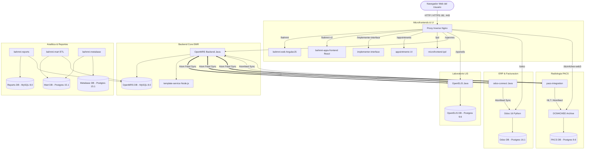

# Expediente Integral de Datos del Sistema Hospitalario Bahmni Standard para Auditoría TIC

> **Documento:** `09_Informes/BAHMNI_DATOS_PARA_AUDITORIA.md`  
> **Fecha de Recopilación y Auditoría:** 2026-10-20  
> **Herramienta de Recopilación:** Google Antigravity IDE  
> **Fuentes de Información:** Documentación oficial de Bahmni Coalition / ThoughtWorks, repositorios de código fuente oficial en GitHub, exportación oficial de Atlassian Confluence Wiki y registro de Docker Hub Registry.  
> **Criterio Epistemológico:** Cada apartado distingue explícitamente entre:
> - `[Hecho documentado]`: Dato verificado directamente en la documentación oficial, especificación, código fuente o volcado del sistema.
> - `[Inferencia técnica]`: Deducción técnica fundamentada a partir de la configuración, variables de entorno, código o arquitectura examinada.
> - `[No encontrado]`: Información que no figura en las fuentes públicas revisadas, indicando dónde se buscó.
> - `[Pendiente de verificación local]`: Aspectos funcionales u operativos que requieren la ejecución efectiva de los contenedores en un entorno con Docker habilitado.

---

## 1. Identificación del Sistema, Edición y Versión

### 1.1 Nombre y Distribución
- **Nombre del Sistema:** Bahmni EMR / Hospital Information Management System (HIMS). `[Hecho documentado]`  
  *Fuente:* [`01_Sistema/bahmni-docker/README.md`](file:///c:/Users/llano/Downloads/PROYEC/Bahmni_Auditoria/01_Sistema/bahmni-docker/README.md) y [`https://www.bahmni.org/`](https://www.bahmni.org/).
- **Edición Seleccionada:** **Bahmni Standard**. `[Hecho documentado]`  
  *Justificación de Selección:* Se prioriza Bahmni Standard por su alcance hospitalario integral, abarcando EMR (OpenMRS), Laboratorio (OpenELIS), ERP/Facturación/Farmacia (Odoo 16), Radiología PACS (DCM4CHEE) y Business Intelligence (Metabase / Bahmni Mart).
- **Distinción entre Ediciones Oficiales:**
  - **Bahmni Standard:** Distribución hospitalaria completa con microservicios clínicos, laboratorio, farmacia, contabilidad y archivo de imágenes diagnósticas.
  - **Bahmni Lite:** Distribución reducida para centros de atención primaria y consultorios ambulatorios (no incluye OpenELIS ni DCM4CHEE por defecto; integra OpenMRS con módulos clínicos esenciales y facturación opcional con Crater o módulo liviano). `[Hecho documentado]`  
    *Fuente:* [`01_Sistema/bahmni-docker/architecture-diagram/`](file:///c:/Users/llano/Downloads/PROYEC/Bahmni_Auditoria/01_Sistema/bahmni-docker/architecture-diagram/).

### 1.2 Versiones Identificadas y Estado de Madurez
- **Versión de la Distribución Desplegada (bahmni-docker):**
  - **Tag `1.0.0-standard`:** Lanzamiento GA oficial de Bahmni Standard (Fecha: 2024-09-17, Tag commit: `67b681fedfdd4195c7b3e8c5d6e834f8b34d5feb`). `[Hecho documentado]`
  - **Tag `1.0.1-standard`:** Parche de mantenimiento (Fecha: 2025-02-05, Tag commit: `25408c9349bbd6bf33fb0cb8beeb5348c72e9fc7`). `[Hecho documentado]`
  - **Tag `1.0.2-standard` (Versión Estable Vigente Recomendada):** Parche de seguridad para corregir vulnerabilidades `BSL-13` y `BSL-14` (Fecha: 2026-07-02, Tag commit: `1dfe62c4e5d6f3d702e65d869729726226fceb56`). `[Hecho documentado]`
  - **Rama Activa de Desarrollo:** `master` (último commit evaluado: `fe2f750367ca195054910e83aaa04312bbeee95d`, Fecha: 2026-10-07). `[Hecho documentado]`
- **Estado de Bahmni Standard 1.0.0 Beta:**
  - La versión `1.0.0 Beta` fue la versión preliminar utilizada por el equipo de ingeniería para las pruebas de carga y estrés ejecutadas en julio de 2024. Su estado fue pre-lanzamiento y sus resultados quedan estrictamente acotados a dicha fase de pruebas. `[Hecho documentado]`  
    *Fuente:* [`05_Pruebas_Rendimiento/BAHMNI_STANDARD_PERFORMANCE_TESTING_REPORTS.md`](file:///c:/Users/llano/Downloads/PROYEC/Bahmni_Auditoria/05_Pruebas_Rendimiento/BAHMNI_STANDARD_PERFORMANCE_TESTING_REPORTS.md).
- **Licenciamiento:**
  - Código y orquestación bajo Licencia de Software Libre **MIT License** y **AGPL v3** en componentes específicos de Odoo/OpenMRS. `[Hecho documentado]`  
    *Fuente:* [`01_Sistema/bahmni-docker/LICENSE`](file:///c:/Users/llano/Downloads/PROYEC/Bahmni_Auditoria/01_Sistema/bahmni-docker/LICENSE) y [`01_Sistema/bahmni-docker/NOTICE`](file:///c:/Users/llano/Downloads/PROYEC/Bahmni_Auditoria/01_Sistema/bahmni-docker/NOTICE).

---

## 2. Objetivo, Alcance y Procesos

### 2.1 Objetivo General
Proveer una solución integral, modular y de código abierto para la gestión clínica, administrativa, paraclínica y diagnóstica de instituciones hospitalarias de mediano y alto nivel de complejidad en entornos de recursos moderados o infraestructura distribuida. `[Hecho documentado]`

### 2.2 Alcance Hospitalario
El alcance de Bahmni Standard cubre de extremo a extremo el ciclo de atención del paciente:
1. **Admisión y Filiación:** Identificación unívoca del paciente, captura de foto, generación de identificador hospitalario (MRN), inicio de visita ambulatoria (OPD) o de urgencia.
2. **Atención Médica Ambulatoria (Consulta Externa / OPD):** Registro de signos vitales, antecedentes, alergias, consulta médica, diagnósticos codificados (CIE-10 / SNOMED CT / CIEL), emisión de órdenes diagnósticas (laboratorio y rayos X) y prescripción farmacológica.
3. **Gestión de Hospitalización (Internación / IPD):** Admisión hospitalaria, asignación y transferencia de camas por salas/pabellones, evolución clínica diaria, notas de enfermería y control de fluidos.
4. **Laboratorio Clínico (LIS - OpenELIS):** Recepción de órdenes generadas en consulta, toma de muestras, registro analítico de resultados, rangos de referencia normales/críticos, validación por patólogo y publicación automática de resultados en la historia del paciente.
5. **Diagnóstico por Imágenes (PACS / Radiología):** Recepción de órdenes radiológicas, adquisición e indexación DICOM mediante DCM4CHEE y visor radiológico integrado.
6. **Farmacia y Cadena de Suministro (Odoo ERP):** Dispensación médica, control de inventario de medicamentos por número de lote y fecha de vencimiento, alertas de stock mínimo y reposición.
7. **Facturación y Cobranzas Médicas (Odoo Accounting):** Cotización automática de prestaciones médicas, generación de facturas, registro de copagos, descuentos y conciliación de cobros.
8. **Inteligencia Institucional y Reportes:** Cubos analíticos y tableros gerenciales con Metabase y Bahmni Mart para indicadores epidemiológicos y de ocupación hospitalaria. `[Hecho documentado]`  
   *Fuente:* [`03_Documentacion_MD/32014338_user-guide.md`](file:///c:/Users/llano/Downloads/PROYEC/Bahmni_Auditoria/03_Documentacion_MD/32014338_user-guide.md) y [`02_Documentacion_Original/Confluence_Bahmni_Export_27Sep2023.pdf`](file:///c:/Users/llano/Downloads/PROYEC/Bahmni_Auditoria/02_Documentacion_Original/Confluence_Bahmni_Export_27Sep2023.pdf).

---

## 3. Módulos y Funciones

| Módulo / Subsistema | Contenedor(es) | Funciones Principales | Tecnologías Base |
|---|---|---|---|
| **Bahmni Web / Apps** | `bahmni-web`<br>`bahmni-apps-frontend` | Interfaz de usuario para médicos, enfermeros y recepcionistas. Tablero clínico, formularios dinámicos, línea de tiempo del paciente. | HTML5, AngularJS 1.x, React, Carbon Design System |
| **OpenMRS EMR Core** | `openmrs`<br>`openmrsdb` | Servidor central de historia clínica, lógica clínica, motor de conceptos, encuentros y visitas. | Java 8/11, Spring Framework, Hibernate, MySQL 8.0 |
| **OpenELIS (LIS)** | `openelis`<br>`openelisdb` | Gestión completa del laboratorio clínico: órdenes, tubos/muestras, analizadores, resultados, validación médica. | Java, Struts/Spring, PostgreSQL 9.6 |
| **Odoo ERP / Billing** | `odoo`<br>`odoodb`<br>`odoo-connect` | Facturación hospitalaria, contabilidad general, compras, farmacia, inventario con seguimiento de lotes. | Python 3.10, Odoo 16, PostgreSQL 16.1 |
| **PACS / Radiología** | `dcm4chee`<br>`pacsdb`<br>`pacs-integration` | Almacenamiento, archivo y comunicación de imágenes médicas DICOM. Protocolo DICOM C-STORE, C-FIND, WADO. | Java JBoss/WildFly, DCM4CHEE 2.18, PostgreSQL 9.6 |
| **Template Service** | `template-service` | Generación y renderizado de recetas médicas, órdenes impresas y documentos PDF para entrega al paciente. | Node.js, Express, Puppeteer/Chrome |
| **Implementer Interface** | `implementer-interface` | Diseñador visual de formularios clínicos (Form Builder), configuración de diagnósticos y esquemas de visualización. | Angular / JavaScript |
| **Bahmni Reports** | `reports`<br>`reportsdb` | Motor de reportes programados y encolados en segundo plano (PDF, Excel, CSV) para auditoría e indicadores de gestión. | Java, Spring, JasperReports, MySQL 8.0 |
| **Metabase & Mart** | `metabase`<br>`metabasedb`<br>`mart`<br>`martdb` | Almacén de datos (Data Mart) transformado para consultas analíticas pesadas sin impactar la base transaccional OpenMRS. | Metabase, Cron ETL, PostgreSQL 15.1 |
| **Proxy Inverso** | `proxy` | Punto único de entrada seguro (Reverse Proxy), enrutamiento de microservicios, terminación SSL y cabeceras de seguridad. | Nginx (Alpine Linux) |

`[Hecho documentado]`  
*Fuente:* [`01_Sistema/bahmni-docker/bahmni-standard/docker-compose.yml`](file:///c:/Users/llano/Downloads/PROYEC/Bahmni_Auditoria/01_Sistema/bahmni-docker/bahmni-standard/docker-compose.yml).

---

## 4. Actores, Roles y Permisos Documentados

### 4.1 Modelo de Seguridad (RBAC)
Bahmni Standard utiliza un esquema RBAC donde los usuarios reciben roles, y los roles agrupan privilegios atómicos en OpenMRS y roles de grupo en Odoo y OpenELIS. `[Hecho documentado]`  
*Fuente:* [`07_Seguridad_y_Operacion/POLITICAS_SEGURIDAD_ROLES_PERMISOS.md`](file:///c:/Users/llano/Downloads/PROYEC/Bahmni_Auditoria/07_Seguridad_y_Operacion/POLITICAS_SEGURIDAD_ROLES_PERMISOS.md).

### 4.2 Matriz de Roles
1. **`Superuser` / Administrador:** Control absoluto sobre OpenMRS, administración de roles, creación de metadatos y acceso a la consola de integración Atomfeed.
2. **`Registration Clerk` (Personal de Admisión):**
   - Privilegios: `App: Registration`, `Add Patient`, `Edit Patient`, `Start Visit`.
   - Restricciones: Sin acceso a notas médicas confidenciales ni dispensación de fármacos.
3. **`Doctor` / `Clinician` (Médico):**
   - Privilegios: `App: Clinical`, `View Patient Dashboard`, `Add Encounter`, `Edit Diagnosis`, `Order Lab Tests`, `Order Radiology`, `Prescribe Medication`.
   - Restricciones: No puede realizar cobros en caja ni modificar lotes de inventario de farmacia.
4. **`Nurse` (Enfermería):**
   - Privilegios: `App: Clinical`, `Add Vitals Observation`, `App: Inpatient`, `Manage Bed Allocation`.
   - Restricciones: No prescribe fármacos ni da de alta médica definitiva.
5. **`Lab Technician` / `Lab Supervisor` (Personal de Laboratorio):**
   - Privilegios: Módulo OpenELIS para captura de muestras, ingreso y validación técnica de pruebas de bioquímica, hematología y microbiología.
6. **`Pharmacist` / `Pharmacy Dispenser` (Farmacia):**
   - Privilegios: Odoo Punto de Venta/Farmacia para dispensar prescripciones, deducción de stock y validación de caducidades.
7. **`Cashier` / `Billing Clerk` (Caja y Facturación):**
   - Privilegios: Módulo de Contabilidad Odoo para emitir cotizaciones, cobrar y facturar.
8. **`Implementer` (Configurador Técnico):**
   - Privilegios: `App: Implementer Interface` para Form Builder y edición de archivos JSON de configuración.

---

## 5. Arquitectura, Componentes e Integraciones

### 5.1 Diagrama y Estilo Arquitectónico
Bahmni Standard sigue una **Arquitectura de Microservicios Híbrida Desacoplada**. No es un monolito; está integrado por aplicaciones independientes de referencia que colaboran mediante eventos asíncronos y APIs REST. `[Hecho documentado]`  
*Fuente:* [`01_Sistema/bahmni-docker/architecture-diagram/bahmni-standard-architecture-diagram.png`](file:///c:/Users/llano/Downloads/PROYEC/Bahmni_Auditoria/01_Sistema/bahmni-docker/architecture-diagram/bahmni-standard-architecture-diagram.png) y [`06_Arquitectura_y_Datos/ARQUITECTURA_Y_DOCUMENTACION_TECNICA.md`](file:///c:/Users/llano/Downloads/PROYEC/Bahmni_Auditoria/06_Arquitectura_y_Datos/ARQUITECTURA_Y_DOCUMENTACION_TECNICA.md).



### 5.2 Mecanismo de Sincronización Atomfeed
- **Fundamento:** Para evitar el acoplamiento rígido de llamadas sincrónicas entre subsistemas de salud distribuidos, Bahmni utiliza feeds web Atom basados en RFC 4287. `[Hecho documentado]`
- **Flujo Operativo:** Cuando un médico prescribe un examen de laboratorio o un fármaco en OpenMRS, OpenMRS publica un evento en el feed (`/openmrs/ws/atomfeed/encounter/recent`). El servicio `openelis` o `odoo-connect` lee periódicamente el feed, descarga la carga útil (payload), crea el registro nativo en su base de datos y almacena un cursor (marcador de último evento procesado). Si la red se interrumpe temporalmente, la sincronización se reanuda de manera consistente e idempotente sin pérdida de transacciones. `[Hecho documentado]`  
  *Fuente:* [`03_Documentacion_MD/3506200_atom-feed-based-synchronization-in-bahmni.md`](file:///c:/Users/llano/Downloads/PROYEC/Bahmni_Auditoria/03_Documentacion_MD/3506200_atom-feed-based-synchronization-in-bahmni.md).

---

## 6. Tecnologías y Dependencias

| Capa Tecnológica | Tecnología / Herramienta | Versión Declarada en Distribución |
|---|---|---|
| **Sistemas Operativos Soportados** | Linux (Ubuntu 20.04/22.04 LTS recomendado), Debian, RHEL/Rocky | Linux kernel 5.x / 6.x `[Hecho documentado]` |
| **Motor de Contenedores** | Docker Engine & Docker Compose | Docker Compose Specification v3.7+ `[Hecho documentado]` |
| **Servidores Web / Reverse Proxy**| Nginx | 1.2x (Imagen `bahmni/proxy:1.1.0`) `[Hecho documentado]` |
| **Lógica Backend Principal** | Java JDK | OpenJDK 8 / 11 `[Hecho documentado]` |
| **Framework EMR** | OpenMRS Core | 2.5.x / 2.6.x (Imagen `bahmni/openmrs:1.1.2`, patch `1.1.3`) `[Hecho documentado]` |
| **Motor ERP / Contable** | Odoo Community Edition | Odoo 16.0 (Python 3.10) `[Hecho documentado]` |
| **Servidor PACS DICOM** | DCM4CHEE | 2.18.1 (JBoss 4.2.3) `[Hecho documentado]` |
| **Bases de Datos Relacionales** | MySQL / Percona Server | MySQL 8.0 (`openmrsdb`, `reportsdb`) `[Hecho documentado]` |
| | PostgreSQL | Postgres 9.6 (`openelisdb`, `pacsdb`), Postgres 15.1 (`metabase`, `mart`), Postgres 16.1 (`odoodb`) `[Hecho documentado]` |
| **Frontend Frameworks** | AngularJS / React / Webpack | AngularJS 1.5, React 18, Carbon Design System `[Hecho documentado]` |
| **Generador de Documentos** | Node.js / Puppeteer | Node 18/20 LTS (`bahmni/bahmni-template-service:1.0.0`) `[Hecho documentado]` |
| **Pruebas de Rendimiento** | Gatling / Scala | Gatling 3.x, Java 11 JDK `[Hecho documentado]` |
| **Pruebas Funcionales** | Playwright / Cypress / Cucumber | Node.js, JavaScript/TypeScript `[Hecho documentado]` |

---

## 7. Requisitos y Procedimiento de Instalación

### 7.1 Requisitos de Infraestructura Recomendados para Bahmni Standard
- **CPU:** Mínimo 4 vCPU (Recomendado 8 vCPU para >50 usuarios concurrentes). `[Hecho documentado]`
- **Memoria RAM:** Mínimo 16 GB RAM (Recomendado 32 GB para operación hospitalaria continua con todos los 21 contenedores activos). `[Hecho documentado]`
- **Almacenamiento:** Mínimo 100 GB en disco SSD de alta velocidad (I/O intensivo en bases de datos e imágenes DICOM). `[Hecho documentado]`
- **Red:** Conexión Gigabit local; IP estática o nombre de dominio FQDN asignado para emisión de certificados TLS. `[Hecho documentado]`  
  *Fuente:* [`05_Pruebas_Rendimiento/BAHMNI_STANDARD_PERFORMANCE_TESTING_REPORTS.md`](file:///c:/Users/llano/Downloads/PROYEC/Bahmni_Auditoria/05_Pruebas_Rendimiento/BAHMNI_STANDARD_PERFORMANCE_TESTING_REPORTS.md).

### 7.2 Procedimiento de Instalación Oficial (Docker Compose)
1. **Descarga de la Distribución:**
   ```bash
   git clone https://github.com/Bahmni/bahmni-docker.git
   cd bahmni-docker/bahmni-standard
   ```
2. **Configuración de Variables de Entorno:**
   - Copiar o editar el archivo `.env`.
   - Seleccionar el perfil compose hospitalario: `COMPOSE_PROFILES=emr` o `COMPOSE_PROFILES=bahmni-standard`.
   - Modificar las contraseñas por defecto (`MYSQL_ROOT_PASSWORD`, `OPENMRS_DB_PASSWORD`, `OPENELIS_DB_PASSWORD`, `ODOO_DB_PASSWORD`, `PACS_DB_ROOT_PASSWORD`).
3. **Descarga de Imágenes de Contenedores:**
   ```bash
   docker compose --env-file .env pull
   ```
4. **Inicio de los Servicios:**
   ```bash
   docker compose --env-file .env up -d
   ```
   *(O utilizando el script interactivo oficial: `./run-bahmni.sh`)*.
5. **Verificación de Salud de Contenedores:**
   - Los contenedores de bases de datos (`openmrsdb`, `openelisdb`, `odoodb`) cuentan con `healthcheck` integrado en Compose. El servicio `openmrs` y `openelis` esperan automáticamente la condición `service_healthy`. `[Hecho documentado]`  
     *Fuente:* [`01_Sistema/bahmni-docker/bahmni-standard/docker-compose.yml`](file:///c:/Users/llano/Downloads/PROYEC/Bahmni_Auditoria/01_Sistema/bahmni-docker/bahmni-standard/docker-compose.yml).

---

## 8. Bases de Datos, Entidades y Esquemas Disponibles

Bahmni Standard mantiene una separación estricta de dominios de almacenamiento relacional:

### 8.1 Catálogo de Bases de Datos
1. **`openmrs` (MySQL 8.0):**
   - *Tablas críticas:* `patient`, `person`, `person_name`, `person_address`, `encounter`, `encounter_type`, `obs` (observaciones clínicas), `orders`, `drug_order`, `concept`, `concept_name`, `concept_numeric`, `users`, `role`, `privilege`.
   - *Modelo de Datos:* Basado en el esquema internacional OpenMRS 2.x Entity-Attribute-Value (EAV) para conceptos clínicos, garantizando extensibilidad ilimitada de formularios sin alterar el DDL de la base de datos. `[Hecho documentado]`
2. **`clinlims` (PostgreSQL 9.6 - OpenELIS):**
   - *Tablas críticas:* `sample`, `sample_item`, `analysis`, `result`, `test`, `test_section`, `panel`, `patient` (sombra), `provider`.
   - *Modelo de Datos:* Esquema especializado de Laboratorio Clínico LIS para el seguimiento de muestras biológicas y control de rangos analíticos. `[Hecho documentado]`
3. **`odoo` (PostgreSQL 16.1 - Odoo ERP):**
   - *Tablas críticas:* `res_partner` (pacientes/clientes), `account_move` (asientos y facturas), `account_move_line`, `sale_order`, `product_template`, `stock_quant` (inventario físico), `stock_lot` (trazabilidad de lotes y vencimientos). `[Hecho documentado]`
4. **`pacs_db` (PostgreSQL 9.6 - DCM4CHEE):**
   - *Tablas críticas:* `patient`, `study`, `series`, `instance`, `files`, `code`. Almacena la jerarquía DICOM completa. `[Hecho documentado]`
5. **`pacs_integration_db` (PostgreSQL 9.6):**
   - Registra el mapeo entre las órdenes radiológicas de OpenMRS y el Study Instance UID de DICOM. `[Hecho documentado]`
6. **`bahmni_reports` (MySQL 8.0):**
   - Esquema intermedio para la preparación, agregación y exportación de reportes hospitalarios. `[Hecho documentado]`
7. **`martdb` y `metabase` (PostgreSQL 15.1):**
   - Almacena el modelo dimensional desnormalizado (tablas de hechos y dimensiones) poblado por los cronjobs de `bahmni-mart` para analítica gerencial. `[Hecho documentado]`

---

## 9. Activos de Información y Datos Tratados

Conforme a buenas prácticas de auditoría TIC y normativas de protección de datos de salud (ISO 27001, HIPAA, leyes locales de historia clínica):

| Categoría de Activo | Ejemplos de Datos Tratados | Nivel de Criticidad | Almacenamiento Físico |
|---|---|---|---|
| **Datos de Identificación del Paciente (PII)** | Nombre completo, género, fecha de nacimiento, cédula de identidad/DNI, dirección, teléfono, fotografía de rostro | **Confidencial / Alto** | Tabla `person`, `patient` en MySQL y volumen `bahmni-patient-images` |
| **Historia Clínica y Diagnósticos (PHI)** | Diagnósticos CIE-10/SNOMED, evolución clínica, signos vitales, alergias, antecedentes patológicos | **Crítico / Confidencial** | Tablas `obs`, `encounter`, `conditions` en OpenMRS MySQL |
| **Resultados Paraclínicos (Laboratorio)** | Muestras sanguíneas, valores analíticos, urocultivos, antibiogramas, observaciones de patología | **Crítico / Confidencial** | Base de datos `clinlims` en Postgres y volumen `bahmni-lab-results` |
| **Imágenes Diagnósticas (Radiología)** | Tomografías (TAC), Radiografías digitales (RX), Resonancias magnéticas, ecografías en formato DICOM | **Crítico / Confidencial** | Volumen Docker `dcm4chee-archive` y base de datos `pacs_db` |
| **Datos Farmacológicos y Prescripción** | Fármacos recetados, posología, vía de administración, lote de medicamento dispensado | **Alto** | Tablas `drug_order` en OpenMRS y `stock_quant` en Odoo |
| **Datos Financieros y de Facturación** | Costo de consultas, coberturas de seguro, cotizaciones, montos pagados, comprobantes fiscales | **Confidencial** | Tablas `account_move` en Odoo PostgreSQL |
| **Credenciales y Secretos de Acceso** | Hashes de contraseñas de personal de salud, tokens API, credenciales de conexión a bases de datos | **Extremo** | Archivo `.env`, variables de entorno en memoria y tabla `users` |

`[Inferencia técnica fundamentada en la revisión de esquemas y volúmenes de Compose]`

---

## 10. Autenticación, Autorización y Registros de Auditoría

### 10.1 Mecanismo de Autenticación
- **Contraseñas:** Almacenadas en OpenMRS con funciones hash seguras (SHA-512 con salt criptográfico por usuario). `[Hecho documentado]`
- **Tokens de Sesión:** Manejo de cookies de sesión HTTP-Only para evitar ataques XSS sobre la sesión clínica del navegador. `[Inferencia técnica]`
- **Autenticación en Dos Factores (2FA):** Bahmni dispone de un repositorio oficial específico (`https://github.com/Bahmni/two-factor-auth`) para habilitar autenticación multifactor cuando es requerido por políticas institucionales. `[Hecho documentado]`

### 10.2 Trazabilidad y Pistas de Auditoría
1. **Auditoría Transaccional:** Cada registro clínico tiene asociado un ID de usuario creador (`creator`) y una marca de tiempo inmutable (`date_created`). Las actualizaciones no sobreescriben la autoría original; registran `changed_by` y `date_changed`. `[Hecho documentado]`
2. **Borrado Lógico Obligatorio:** Los errores o registros anulados conservan su fila en base de datos marcando `voided = 1`, `voided_by = <usuario>` y un motivo obligatorio `void_reason`. No se ejecutan sentencias `DELETE` sobre registros clínicos durante la operación. `[Hecho documentado]`
3. **Pistas de Auditoría de Integración:** El subsistema Atomfeed registra cada evento procesado o fallido en tablas de eventos, permitiendo reconstruir exactamente qué eventos fueron transmitidos y cuándo. `[Hecho documentado]`
4. **Registros de Acceso HTTP:** El proxy Nginx registra cada petición entrante con IP cliente, método, URL, código de respuesta HTTP y timestamp. `[Hecho documentado]`  
   *Fuente:* [`07_Seguridad_y_Operacion/REGISTROS_AUDITORIA_Y_TRAZABILIDAD.md`](file:///c:/Users/llano/Downloads/PROYEC/Bahmni_Auditoria/07_Seguridad_y_Operacion/REGISTROS_AUDITORIA_Y_TRAZABILIDAD.md).

---

## 11. Respaldos, Restauración y Mantenimiento Operativo

### 11.1 Política y Procedimiento de Respaldo
- **Script Oficial:** `01_Sistema/bahmni-docker/bahmni-standard/backup_bahmni_standard.sh`.
- **Alcance del Respaldo:**
  - 7 volcados SQL de bases de datos: `openmrsdb_backup.sql`, `reportsdb_backup.sql`, `openelisdb_backup.sql`, `odoodb_backup.sql`, `odoo_10_db_backup.sql`, `dcm4cheedb_backup.sql`, `pacs_integrationdb_backup.sql`.
  - 9 árboles de archivos de datos: `document_images`, `uploaded_results`, `uploaded-files`, `patient_images`, `clinical_forms`, `configuration_checksums`, `reports`, `filestore` (Odoo) y `dcm4chee_archive` (DICOM).
- **Consistencia:** Los volcados se generan en caliente mientras los motores SQL garantizan consistencia transaccional mediante mecanismos de snapshot/dump (`mysqldump` y `pg_dump`). `[Hecho documentado]`

### 11.2 Procedimiento de Restauración
- **Script Oficial:** `01_Sistema/bahmni-docker/bahmni-standard/restore_bahmni_standard.sh`.
- **Operación:** Recibe la ruta del directorio del artefacto de respaldo, ejecuta la restauración de bases de datos recreando los esquemas e invoca el contenedor efímero `restore_volumes` para reconstruir los volúmenes Docker de almacenamiento. `[Hecho documentado]`  
  *Fuente:* [`07_Seguridad_y_Operacion/PROCEDIMIENTO_RESPALDO_Y_RESTAURACION.md`](file:///c:/Users/llano/Downloads/PROYEC/Bahmni_Auditoria/07_Seguridad_y_Operacion/PROCEDIMIENTO_RESPALDO_Y_RESTAURACION.md).

---

## 12. Desarrollo, Versiones e Historial Disponible

### 12.1 Repositorios y Trazabilidad Git en el Expediente
Todos los repositorios han sido clonados preservando su trazabilidad Git:
1. `bahmni-docker`: Rama `master`, tags `1.0.0-standard`, `1.0.1-standard`, `1.0.2-standard` (commit `1dfe62c4e5d6f3d702e65d869729726226fceb56`, parche de seguridad `BSL-13/BSL-14`).
2. `default-config`: Tag `1.0.0` (commit `6b2ab4f6b61c40f125cc3f5f71c170803a05e872`).
3. `bahmni-odoo-modules`: Commit `f1691c9a33403a73d72132a7e7f7140fd4ab0c5f`.
4. `pacs-integration`: Commit `72cf630b281ff61dfa03c8b9678c76899ee249ff`.
5. `bahmni-core`: Commit `4eb74aa001dec8a7c6f7337fe15006188efff43d`.
6. `openmrs-module-bahmniapps`: Commit `5b18fb2639cf6dbf4369a19cba535d481691c781`.
7. `bahmni-decision-records`: Commit `c1b6db1aa6b15b7bb0a2f98d2ec9e88f42905822`. `[Hecho documentado]`  
   *Fuente:* [`08_Inventarios/INVENTARIO_COMPONENTES.csv`](file:///c:/Users/llano/Downloads/PROYEC/Bahmni_Auditoria/08_Inventarios/INVENTARIO_COMPONENTES.csv).

---

## 13. Pruebas Funcionales: Casos, Herramientas y Resultados

### 13.1 Suites de Pruebas Recopiladas
1. **`bahmni-lite-e2e-tests`:**
   - *Herramientas:* Playwright, Cypress, Cucumber / Gherkin.
   - *Casos de Prueba Documentados:* Registro de paciente nuevo, búsqueda por ID y nombre, inicio de visita OPD, registro de signos vitales, consulta médica, orden de laboratorio, prescripción de medicamentos, carga de documentos clínicos, flujo de facturación. `[Hecho documentado]`  
     *Ubicación:* `04_Pruebas_Funcionales/bahmni-lite-e2e-tests/`.
2. **`bahmni-appointments-functional-tests`:**
   - *Herramientas:* TestNG, Selenium / WebDriver.
   - *Casos de Prueba Documentados:* Creación de disponibilidad de médicos, agendamiento de citas, modificación de citas, estados de cita (espera, atendido, cancelado). `[Hecho documentado]`  
     *Ubicación:* `04_Pruebas_Funcionales/bahmni-appointments-functional-tests/`.

### 13.2 Estado de Resultados de Pruebas Funcionales
- **Aclaración Auditora Fundamental:** Las pruebas funcionales existentes en estos repositorios corresponden a las suites automatizadas desarrolladas por la comunidad Bahmni para su integración continua (CI en GitHub Actions). En esta etapa de recopilación documental **no se ejecutaron pruebas en vivo en el equipo local**, por lo que no se formula ninguna afirmación de aprobación o desaprobación sobre el entorno local. `[Pendiente de verificación local]`

---

## 14. Pruebas de Rendimiento: Escenarios, Métricas y Resultados

> [!IMPORTANT]
> **Delimitación de Versión:** Los siguientes resultados corresponden de forma exclusiva y oficial a las pruebas ejecutadas sobre **Bahmni Standard 1.0.0 Beta** por el equipo de ingeniería de Bahmni en julio de 2024. No deben atribuirse a otras versiones. `[Hecho documentado]`  
> *Fuente Oficial:* [`05_Pruebas_Rendimiento/BAHMNI_STANDARD_PERFORMANCE_TESTING_REPORTS.md`](file:///c:/Users/llano/Downloads/PROYEC/Bahmni_Auditoria/05_Pruebas_Rendimiento/BAHMNI_STANDARD_PERFORMANCE_TESTING_REPORTS.md).

### 14.1 Entorno de Prueba Publicado
- **Servidor bajo Prueba:** AWS EC2 `m5.xlarge` (4 vCPU, 16 GB RAM, 100 GB SSD, Ubuntu 22.04 LTS).
- **Contenedores en Ejecución:** 21 contenedores activos simultáneamente (OpenMRS MySQL 8.0, OpenELIS Postgres 9.6, Odoo Postgres 16.1, PACS Postgres 9.6, agentes cadvisor y node-exporter).
- **Volumen de Datos Base:** Diccionario CIEL con 56,884 conceptos, 170,167 términos de referencia, 99,995 pacientes sintéticos pre-cargados, 70,931 visitas y 425,586 observaciones clínicas generadas con `bahmni-test-data-generator`.
- **Servidor Generador de Carga:** AWS EC2 `c5.xlarge` (4 vCPU, 16 GB RAM) ejecutando suite Gatling en Java 11.

### 14.2 Resumen Consolidado de Pruebas de Carga Ejecutadas

| Test ID | Usuarios Concurrentes | Duración | Pacientes Creados | Visitas Creadas | CPU Promedio | Red Promedio | Errores Registrados | P95 Consulta Médica (ms) | P99 Consulta Médica (ms) |
|---|---|---|---|---|---|---|---|---|---|
| **Test 1** | 70 usuarios | 4 horas | 1,730 | 4,991 | ~35% | ~250 KB/s | 0 errores | 701 ms | 876 ms |
| **Test 2** | 70 usuarios | 8 horas | 3,410 | 9,912 | ~35% | ~250 KB/s | 20 llamadas fallidas HTTP 400 (intento de orden de fármaco duplicado ya activo) | 718 ms | 952 ms |
| **Test 3** | 120 usuarios | 8 horas | 5,810 | 17,449 | ~63% | ~500 KB/s | 151 llamadas fallidas HTTP 400 | 867 ms | 1,257 ms (degradación leve P99) |
| **Test 4** | 120 usuarios | 24 horas | 17,336 | 51,462 | ~63% | ~500 KB/s | 884 fallos HTTP 400; 3 peticiones con fallo HTTP 502 (delete session, getAllObservation Templates, getActive visits) | 948 ms | 1,413 ms (Máx: 4,015 ms) |
| **Test 5** | 200 usuarios | 8 horas | 9,110 | 28,142 | >75% (saturación) | ~750 KB/s | 1,262 fallos HTTP 400; 3 peticiones con fallo HTTP 502 | 2,481 ms (excedió umbral esperado de 1000 ms) | 3,500+ ms |

### 14.3 Cuellos de Botella y Hallazgos Críticos de Rendimiento
1. **Límite de Carga de la Instancia `m5.xlarge`:** Hasta 120 usuarios concurrentes, el sistema mantiene tiempos de respuesta P95 inferiores a 1 segundo en consultas médicas complejas (con diagnóstico, prescripción y 2 órdenes de laboratorio). A 200 usuarios concurrentes, el tiempo de respuesta del endpoint `post encounter` sube a 2,481 ms, indicando la necesidad de escalar horizontalmente OpenMRS o incrementar vCPUs. `[Hecho documentado]`
2. **Consultas SQL Pesadas de Búsqueda:** El endpoint `emrapi.sqlSearch.activePatientsByLocation` mostró tiempos máximos de 4,056 ms en la prueba de 24 horas, recomendándose indexación adicional o particionamiento. `[Hecho documentado]`
3. **Disponibilidad de Evidencias Locales:** Todos los informes HTML completos generados por Gatling y las gráficas PNG de monitoreo de CPU/red han sido descargados en `05_Pruebas_Rendimiento/recursos_informes/`. `[Hecho documentado]`

---

## 15. Incidencias, Limitaciones y Correcciones Documentadas

1. **Parche de Seguridad Bahmni Standard 1.0.2:** En julio de 2026 se documentaron y corrigieron los fallos de seguridad `BSL-13` y `BSL-14` elevando la versión de OpenMRS a `1.1.3`. `[Hecho documentado]`  
   *Fuente:* Git log tag `1.0.2-standard`.
2. **Fallos HTTP 400 en Creación de Encuentros bajo Estrés:** Durante las pruebas de carga masiva, los scripts generaron fallos HTTP 400 cuando el simulador intentó asociar una orden de medicación a un paciente que ya tenía la misma orden activa. Se identificó como limitación del script generador de escenarios y no corrupción de datos del EMR. `[Hecho documentado]`
3. **Fallos Esporádicos HTTP 502:** En pruebas de 24 horas a 120 y 200 usuarios, se presentaron fallos aislados 502 Bad Gateway en peticiones de sesión hacia Nginx provocados por picos de recolección de basura (Garbage Collection) en la máquina virtual Java de Tomcat. `[Hecho documentado]`
4. **Imagen `bahmni/pacs-simulator:1.0.0` no localizada:** En el registro público de Docker Hub la etiqueta 1.0.0 arrojó código 404, por lo que este componente opcional de simulación queda catalogado como no disponible en Docker Hub. `[Hecho documentado]`  
   *Fuente:* [`08_Inventarios/FALTANTES_Y_LIMITACIONES.md`](file:///c:/Users/llano/Downloads/PROYEC/Bahmni_Auditoria/08_Inventarios/FALTANTES_Y_LIMITACIONES.md).

---

## 16. Documentación Disponible y Faltante

### 16.1 Documentación Disponible
- **Expediente PDF Oficial Consolidado:** `Confluence_Bahmni_Export_27Sep2023.pdf` (154.7 MB, íntegramente descargado y verificado en `02_Documentacion_Original/`).
- **Páginas Confluence en Markdown y HTML:** Más de 300 páginas de la Wiki de Bahmni extraídas vía REST API en `03_Documentacion_MD/` y `02_Documentacion_Original/wiki_pages/`.
- **Manuales de Usuario y Administrador:** Cobertura de flujos clínicos, admisión, hospitalización, laboratorio y configuración en `03_Documentacion_MD/`.
- **Guías de Procedimiento Operativo:** Respaldos, restauración, roles, seguridad y trazabilidad documentados en `07_Seguridad_y_Operacion/`.
- **Informes de Rendimiento Completos:** Reportes Gatling e imágenes en `05_Pruebas_Rendimiento/recursos_informes/`.

### 16.2 Documentación No Encontrada o Faltante en Fuentes Públicas
1. **Especificación Formal de Requisitos (SRS) IEEE 830 en documento único:** `[No encontrado]`  
   *Detalle:* Se buscó en Atlassian Confluence y en la organización GitHub. Bahmni documenta sus requisitos de manera ágil distribuida a través de tickets Jira (proyecto `BAH`), historias de usuario en la Wiki y especificaciones ejecutables de Cucumber (`.feature`), pero no dispone de un documento formal tradicional SRS consolidado.
2. **Certificación Oficial ISO 27001 o ISO 13485 emitida al software:** `[No encontrado]`  
   *Detalle:* Al ser un proyecto de software libre comunitario, la certificación formal no se emite sobre el repositorio público de código, sino sobre el Sistema de Gestión de Seguridad de la Información (SGSI) de la institución hospitalaria que lo implementa.

---

## 17. Información Pendiente de Comprobar Mediante Instalación u Observación Local

Los siguientes aspectos técnicos quedan expresamente registrados como `[Pendiente de verificación local]` para la siguiente etapa de auditoría práctica:
1. **Tiempo real de inicialización en frío:** Medición de tiempo transcurrido desde `docker compose up -d` hasta que los 21 contenedores reporten estado `healthy` y los puertos 80/443 respondan HTTP 200 en hardware local.
2. **Comprobación de la interfaz gráfica local:** Verificación visual de renderizado en navegador de las pantallas de login, registro, tablero clínico y visualizador DICOM.
3. **Validación empírica de respaldo y restauración:** Ejecución de `backup_bahmni_standard.sh`, verificación de los archivos SQL producidos y ejecución de `restore_bahmni_standard.sh` comprobando que las historias clínicas restauradas sean accesibles sin corrupción.
4. **Pruebas de penetración y escaneo local de vulnerabilidades:** Ejecución de escaneos dinámicos DAST (OWASP ZAP) y SAST sobre las imágenes de contenedores descargadas.

---

## 18. Referencias y Rutas Locales del Expediente

Todas las evidencias se encuentran archivadas y consultables en el sistema de archivos local:

- **Expediente Raíz:** [`c:\Users\llano\Downloads\PROYEC\Bahmni_Auditoria\`](file:///c:/Users/llano/Downloads/PROYEC/Bahmni_Auditoria/)
- **Guía de Inicio:** [`README_INICIO.md`](file:///c:/Users/llano/Downloads/PROYEC/Bahmni_Auditoria/README_INICIO.md)
- **Código y Despliegue:** [`01_Sistema/bahmni-docker/bahmni-standard/`](file:///c:/Users/llano/Downloads/PROYEC/Bahmni_Auditoria/01_Sistema/bahmni-docker/bahmni-standard/)
- **Documento PDF Oficial Confluence (154.7 MB):** [`02_Documentacion_Original/Confluence_Bahmni_Export_27Sep2023.pdf`](file:///c:/Users/llano/Downloads/PROYEC/Bahmni_Auditoria/02_Documentacion_Original/Confluence_Bahmni_Export_27Sep2023.pdf)
- **Páginas Wiki en Markdown:** [`03_Documentacion_MD/`](file:///c:/Users/llano/Downloads/PROYEC/Bahmni_Auditoria/03_Documentacion_MD/)
- **Suites de Pruebas Funcionales:** [`04_Pruebas_Funcionales/`](file:///c:/Users/llano/Downloads/PROYEC/Bahmni_Auditoria/04_Pruebas_Funcionales/)
- **Informes de Rendimiento y Gatling:** [`05_Pruebas_Rendimiento/`](file:///c:/Users/llano/Downloads/PROYEC/Bahmni_Auditoria/05_Pruebas_Rendimiento/)
- **Arquitectura y Decision Records (ADR):** [`06_Arquitectura_y_Datos/`](file:///c:/Users/llano/Downloads/PROYEC/Bahmni_Auditoria/06_Arquitectura_y_Datos/)
- **Procedimientos de Seguridad y Respaldos:** [`07_Seguridad_y_Operacion/`](file:///c:/Users/llano/Downloads/PROYEC/Bahmni_Auditoria/07_Seguridad_y_Operacion/)
- **Inventarios y Manifiesto Criptográfico SHA-256:** [`08_Inventarios/`](file:///c:/Users/llano/Downloads/PROYEC/Bahmni_Auditoria/08_Inventarios/)
- **Informe Principal para Auditoría TIC:** [`09_Informes/BAHMNI_DATOS_PARA_AUDITORIA.md`](file:///c:/Users/llano/Downloads/PROYEC/Bahmni_Auditoria/09_Informes/BAHMNI_DATOS_PARA_AUDITORIA.md)
