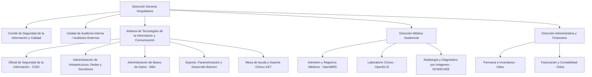
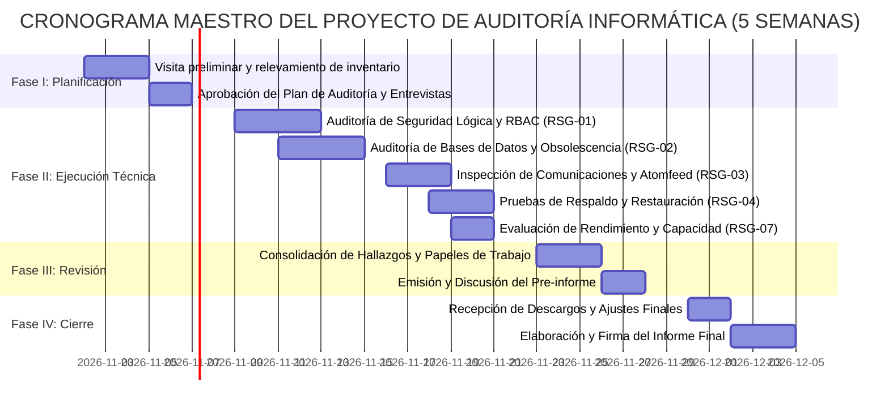

# LEVANTAMIENTO DE INFORMACIÓN TÉCNICA, ANÁLISIS DE RIESGOS Y PERFIL DE AUDITORÍA
## SISTEMA DE INFORMACIÓN HOSPITALARIA BAHMNI STANDARD — ACTIVIDADES ACADÉMICAS 1 Y 2

> **Documento Maestro de Levantamiento Técnico:** `LEVANTAMIENTO_BAHMNI_ACTIVIDADES_1_Y_2.md`  
> **Asignatura:** Auditoría Informática  
> **Discrepancia de Sigla Curricular Registrada:** `INF 841` (consignada formalmente en `Actividad_grupal2.pdf`) vs. `INF 881` (consignada en `Actividad1.pdf`). `[DOCUMENTADO / PENDIENTE DE CONFIRMACIÓN]`  
> **Docente Evaluador Académico:** Lic. Erick Sierra Caballero *(Nota: Es el evaluador académico de la asignatura; no forma parte de la organización evaluada ni de su personal técnico)*. `[DOCUMENTADO: Actividad1.pdf, Actividad_grupal2.pdf]`  
> **Equipo Auditor de Trabajo (Roles Académicos):**
> 1. **Alfredo Llanos Taca:** Máster del equipo y auditor líder.
> 2. **Lucy Zoraida Beltrán Tarqui:** Auditora de seguridad y accesos.
> 3. **Anny Britney Bohorquez Burgos:** Auditora de procesos e información.
> 4. **Eloy Moisés Meneses Jancko:** Auditor de infraestructura y continuidad.  
> `[DOCUMENTADO: Requerimiento del usuario / ROLES ASIGNADOS]`  
> **Sistema Evaluado:** Bahmni Hospital Information Management System (HIMS) / Electronic Medical Record (EMR).  
> **Edición y Versión Base Analizada:** **Bahmni Standard v1.0.2-standard** (Tag oficial `v1.0.2-standard`, Commit `1dfe62c4e5d6f3d702e65d869729726226fceb56`). `[DOCUMENTADO PARA LA VERSIÓN ANALIZADA / OBSERVADO LOCALMENTE]`  
> **Fecha de Ejecución del Levantamiento:** 20 de octubre de 2026. `[OBSERVADO LOCALMENTE]`  
> **Ubicación del Expediente Técnico:** `c:\Users\llano\Downloads\PROYEC\Bahmni_Auditoria\` (Volumen local NTFS, Host ID: `DESKTOP-FJP4IH3`). `[OBSERVADO LOCALMENTE]`  
> **Carácter de la Inspección:** Levantamiento documental pasivo, inspección estática de código fuente, análisis de directivas de configuración Compose/YAML, verificación de esquemas de bases de datos y contraste con reportes oficiales. Operación estrictamente de solo lectura, sin ejecución destructiva, sin inyección de carga ni explotación activa. `[OBSERVADO LOCALMENTE]`  

---

## 1. FUENTES Y REGLAS DE EXTRACCIÓN

### 1.1 Metodología de Observación y Límites Epistemológicos

El presente levantamiento recopila y organiza la evidencia técnica del sistema Bahmni Standard para servir de insumo directo en la elaboración posterior de la **Actividad 1 (Diagnóstico y Análisis de Riesgos con Metodología ISO/IEC 27005)** y de la **Actividad 2 (Perfil del Proyecto de Auditoría Informática)**. Se aplican de forma categórica las siguientes reglas:

1. **Inspección Pasiva y de Solo Lectura:** Toda la información técnica proviene del análisis de archivos en reposo, árboles de directorios, manifiestos de Docker Compose, variables de entorno de ejemplo, scripts de automatización, código fuente Java/Python/JavaScript, modelos relacionales de datos y documentación oficial histórica. No se han iniciado contenedores, no se han modificado usuarios o contraseñas, no se han alterado registros clínicos ni se han ejecutado escaneos de red intrusivos.
2. **Sistema de Etiquetado de Certeza Epistemológica:** Cada afirmación, parámetro técnico, métrica o control consignado en este documento está calificado unívocamente con una de las seis etiquetas normativas:
   - `[OBSERVADO LOCALMENTE]`: Comprobado directamente en el sistema de archivos del expediente local, en los repositorios clonados o en el entorno anfitrión de trabajo (`Bahmni_Auditoria`).
   - `[DOCUMENTADO PARA LA VERSIÓN ANALIZADA]`: Registrado explícitamente en la documentación oficial, guías de usuario, manuales de implementación o archivos de configuración correspondientes a la distribución **Bahmni Standard v1.0.2-standard**.
   - `[DOCUMENTADO PARA OTRA VERSIÓN]`: Dato obtenido de documentación o pruebas realizadas sobre ramas o versiones anteriores o preliminares (por ejemplo, resultados de pruebas de carga ejecutadas exclusivamente sobre **Bahmni Standard 1.0.0 Beta** en julio de 2024, o manuales de Bahmni 0.92/0.93 bajo CentOS).
   - `[INFERENCIA TÉCNICA JUSTIFICADA]`: Deducción lógica, técnica o arquitectónica fundada a partir de directivas de configuración, código fuente, variables de entorno o dependencias examinadas, justificando la derivación realizada.
   - `[PROPUESTA PARA LA AUDITORÍA]`: Planteamiento metodológico, objetivo específico, procedimiento o criterio de evaluación formulado por el equipo auditor para la ejecución de la auditoría.
   - `[PENDIENTE DE CONFIRMACIÓN]`: Información requerida por las guías académicas que no se encuentra en el repositorio local ni en fuentes oficiales públicas, o que requiere decisión formal de la organización usuaria o del docente.
3. **Identificadores Unívocos de Fuentes (`E-001` a `E-040`):** Todas las referencias técnicas citan el identificador correspondiente de la fuente primaria (registrado con su ruta absoluta/relativa, URL, sección, fecha de versión y versión aplicable).
4. **Prohibición de Invención de Datos Institucionales:** Conforme a las instrucciones expresas, **no se inventan hospitales, clínicas, puestos de trabajo, empleados, entrevistas, políticas aprobadas ni incidentes ficticios**. En ausencia de una institución definida por el usuario, el sistema se identifica formalmente como: *"Institución usuaria pendiente de definición; análisis del expediente/laboratorio Bahmni"*.
5. **Diferenciación entre el Ejemplo Académico y el Objeto Real de Auditoría:** Se excluyen totalmente los datos del caso de juguete "SICAF" (comercializadora farmacéutica) presentado con fines ilustrativos en las guías `Actividad1.pdf` y `Actividad_grupal2.pdf`.
6. **Valoración Epistemológica de Controles:** La inexistencia de un manual o archivo en el repositorio no prueba automáticamente la ausencia del control en un entorno en producción, pero acredita la **falta de evidencia documental observable en el expediente analizado**.
7. **Tratamiento de Secretos y Credenciales:** No se exponen contraseñas reales ni tokens productivos. Las cadenas por defecto identificadas en archivos `.env` o Compose se citan con propósitos de auditoría de seguridad lógica señalando su carácter de vulnerabilidad por omisión de personalización.
8. **Segregación entre Resultados Históricos y Pruebas Locales:** Los informes de rendimiento de Gatling alojados en `05_Pruebas_Rendimiento/` corresponden a pruebas históricas publicadas por la comunidad sobre infraestructura AWS; se reportan como tales y no como mediciones efectuadas sobre la máquina local.

---

### 1.2 Catálogo Inicial de Fuentes de Evidencia Primaria

| Identificador | Título / Recurso Documental | Ruta Local / URL Oficial | Versión / Rama / Commit | Sección / Archivo Clave | Naturaleza de la Evidencia |
| :--- | :--- | :--- | :--- | :--- | :--- |
| **E-001** | Orquestación Docker Bahmni Standard | `01_Sistema/bahmni-docker/` | v1.0.2-standard (`1dfe62c4`) | `bahmni-standard/docker-compose.yml`, `.env-standard` | `[OBSERVADO LOCALMENTE]` |
| **E-002** | Configuración Clínica por Defecto | `01_Sistema/default-config/` | Tag 1.0.0 (`6b2ab4f6`) | `openmrs/apps/clinical/app.json`, `extension.json` | `[OBSERVADO LOCALMENTE]` |
| **E-003** | Módulos Odoo ERP Bahmni | `01_Sistema/bahmni-odoo-modules/` | main (`f1691c9a`) | `bahmni_account/`, `bahmni_pharmacy/` | `[OBSERVADO LOCALMENTE]` |
| **E-004** | Integración PACS / DICOM | `01_Sistema/pacs-integration/` | master (`72cf630b`) | `src/main/resources/application.yml` | `[OBSERVADO LOCALMENTE]` |
| **E-005** | Núcleo Clínico OpenMRS Bahmni | `01_Sistema/bahmni-core/` | master (`4eb74aa0`) | `bahmni-atomfeed-client/`, `pom.xml` | `[OBSERVADO LOCALMENTE]` |
| **E-006** | Exportación Oficial Confluence Wiki PDF | `02_Documentacion_Original/Confluence_Bahmni_Export_27Sep2023.pdf` | Versión 27/09/2023 (154.7 MB) | Documentación integral wiki (OpenMRS, OpenELIS, Odoo) | `[DOCUMENTADO PARA LA VERSIÓN ANALIZADA]` |
| **E-007** | Wiki Oficial Bahmni Convertida a Markdown | `03_Documentacion_MD/` | 456 archivos Markdown convertidos | `32014338_user-guide.md`, `32014340_admin-guide.md` | `[OBSERVADO LOCALMENTE]` |
| **E-008** | Suite Pruebas E2E Bahmni Lite | `04_Pruebas_Funcionales/bahmni-lite-e2e-tests/` | main (`de34c2f3`) | `specs/`, Playwright/Cucumber configs | `[OBSERVADO LOCALMENTE]` |
| **E-009** | Suite Pruebas Citas Funcionales | `04_Pruebas_Funcionales/bahmni-appointments-functional-tests/` | master (`6548b2df`) | `features/appointments.feature` | `[OBSERVADO LOCALMENTE]` |
| **E-010** | Suite Pruebas de Rendimiento Gatling | `05_Pruebas_Rendimiento/performance-test/` | master (`ecab765f`) | `src/test/scala/bahmni/scenarios/` | `[OBSERVADO LOCALMENTE]` |
| **E-011** | Generador Sintético de Datos | `05_Pruebas_Rendimiento/bahmni-test-data-generator/` | main (`a65b9ebc`) | `README.md`, `generator.py` | `[OBSERVADO LOCALMENTE]` |
| **E-012** | Reportes Históricos Rendimiento Bahmni | `05_Pruebas_Rendimiento/BAHMNI_STANDARD_PERFORMANCE_TESTING_REPORTS.md` | Bahmni 1.0.0 Beta (Julio 2024) | Reporte 70, 120 y 200 usuarios concurrentes | `[DOCUMENTADO PARA OTRA VERSIÓN]` |
| **E-013** | Reportes Gatling HTML y Gráficas de Carga | `05_Pruebas_Rendimiento/recursos_informes/` | 5 reportes HTML + 4 gráficas PNG | `gatling_70_users/index.html`, `cpu_usage_m5xlarge.png` | `[DOCUMENTADO PARA OTRA VERSIÓN]` |
| **E-014** | Registros de Decisiones Arquitectónicas | `06_Arquitectura_y_Datos/bahmni-decision-records/` | main (`c1b6db1a`) | ADRs en Markdown | `[OBSERVADO LOCALMENTE]` |
| **E-015** | Arquitectura y Documentación Técnica | `06_Arquitectura_y_Datos/ARQUITECTURA_Y_DOCUMENTACION_TECNICA.md` | Síntesis de Arquitectura | Diagrama de contenedores, puertos y bases de datos | `[OBSERVADO LOCALMENTE]` |
| **E-016** | Procedimiento Respaldo y Restauración | `07_Seguridad_y_Operacion/PROCEDIMIENTO_RESPALDO_Y_RESTAURACION.md` | Guía Operativa de Backup | Scripts `backup.sh`, `restore.sh`, comandos nativos | `[OBSERVADO LOCALMENTE]` |
| **E-017** | Políticas de Seguridad, Roles y Permisos | `07_Seguridad_y_Operacion/POLITICAS_SEGURIDAD_ROLES_PERMISOS.md` | Matriz RBAC | Roles OpenMRS, permisos Odoo y OpenELIS | `[OBSERVADO LOCALMENTE]` |
| **E-018** | Configuración Segura y Mantenimiento | `07_Seguridad_y_Operacion/CONFIGURACION_SEGURA_Y_MANTENIMIENTO.md` | Guía de Hardening | SSL, cortafuegos, secretos y actualización | `[OBSERVADO LOCALMENTE]` |
| **E-019** | Registros de Auditoría y Trazabilidad | `07_Seguridad_y_Operacion/REGISTROS_AUDITORIA_Y_TRAZABILIDAD.md` | Trazabilidad y Logs | OpenMRS Audit Log, PostgreSQL WAL, Nginx logs | `[OBSERVADO LOCALMENTE]` |
| **E-020** | Inventario Documental y de Manifiestos | `08_Inventarios/INVENTARIO_DOCUMENTAL.csv` | Catálogo de 5,554 archivos | Registro indexado con rutas relativas | `[OBSERVADO LOCALMENTE]` |
| **E-021** | Catálogo de Imágenes Docker Hub | `08_Inventarios/LISTA_IMAGENES_CONTENEDORES.csv` | 29 imágenes consultadas vía API | Digests SHA256 verificados en Docker Hub | `[OBSERVADO LOCALMENTE]` |
| **E-022** | Análisis de Brechas y Limitaciones | `08_Inventarios/FALTANTES_Y_LIMITACIONES.md` | Matriz de Limitaciones | Docker CLI no en PATH, imagen pacs-simulator 404 | `[OBSERVADO LOCALMENTE]` |
| **E-023** | Manifiesto Criptográfico SHA256 | `08_Inventarios/MANIFEST_SHA256.txt` | Hashes de archivos locales | Integridad del expediente completo | `[OBSERVADO LOCALMENTE]` |
| **E-024** | Guía Académica de Actividad 1 | `c:\Users\llano\Documents\OCTAVO SEMESTRE\AUDITORIA\Actividad1.pdf` | Docente Lic. Erick Sierra | Metodología ISO/IEC 27005, Planillas 1, 2, 3 y 4 | `[DOCUMENTADO PARA LA VERSIÓN ANALIZADA]` |
| **E-025** | Guía Académica de Actividad Grupal 2 | `c:\Users\llano\Documents\OCTAVO SEMESTRE\AUDITORIA\Actividad_grupal2.pdf` | Docente Lic. Erick Sierra | Perfil de Auditoría, Secciones 1 a 12 | `[DOCUMENTADO PARA LA VERSIÓN ANALIZADA]` |

---

## 2. IDENTIFICACIÓN Y CONTEXTO DEL SISTEMA

### 2.1 Ficha Técnica Integral de Bahmni Standard

- **Nombre Oficial del Software:** Bahmni Hospital Information Management System (HIMS) / Electronic Medical Record (EMR). `[DOCUMENTADO PARA LA VERSIÓN ANALIZADA: E-006, E-007]`
- **Propósito y Finalidad Principal:** Proveer una solución informática hospitalaria integral de código abierto que unifica la gestión de historias clínicas electrónicas (EMR), sistemas paraclínicos de laboratorio (LIS), archivos y comunicación de imágenes médicas (PACS/DICOM), gestión de suministros y farmacia, facturación y contabilidad médica (ERP), y análisis estadístico en salud para hospitales e instituciones prestadoras de servicios de salud en regiones con recursos moderados o en desarrollo. `[DOCUMENTADO PARA LA VERSIÓN ANALIZADA: E-006]`
- **Comunidad Desarrolladora vs. Entidad Usuaria:**
  - *Comunidad Desarrolladora:* **Bahmni Coalition** (impulsada originalmente por ThoughtWorks Global Health, y gobernada por una coalición que incluye a Digital Square, Medic Mobile, OpenMRS Inc. e implementadores internacionales). `[DOCUMENTADO PARA LA VERSIÓN ANALIZADA: E-006]`
  - *Organización Usuaria:* **Institución usuaria pendiente de definición; análisis del expediente/laboratorio Bahmni**. No se asigna una entidad ficticia para no alterar la veracidad del proceso auditor. `[PENDIENTE DE CONFIRMACIÓN / PROPUESTA PARA LA AUDITORÍA]`
- **Edición Seleccionada y Justificación:** **Bahmni Standard**. A diferencia de Bahmni Lite (que reduce la arquitectura a un EMR ambulatorio con facturación básica), la edición Standard despliega los cuatro pilares clínicos hospitalarios: OpenMRS (clínica), OpenELIS (laboratorio), Odoo 16 (farmacia/ERP) y DCM4CHEE (radiología), integrados asíncronamente mediante el protocolo Atomfeed. `[DOCUMENTADO PARA LA VERSIÓN ANALIZADA: E-001, E-015]`
- **Versión de Despliegue Evaluada:** **Tag `1.0.2-standard`** (lanzamiento oficial correctivo de mantenimiento y seguridad emitido el 02 de julio de 2026, commit `1dfe62c4e5d6f3d702e65d869729726226fceb56` en repositorio `bahmni-docker`). Corrige los tickets de seguridad y compatibilidad `BSL-13` y `BSL-14`. `[DOCUMENTADO PARA LA VERSIÓN ANALIZADA / OBSERVADO LOCALMENTE: E-001]`
- **Componentes Satélites Descargados y Verificados:**
  1. `default-config`: Tag oficial `1.0.0` (commit `6b2ab4f6b61c40f125cc3f5f71c170803a05e872`). `[OBSERVADO LOCALMENTE: E-002]`
  2. `bahmni-odoo-modules`: Versión Odoo 16 (rama `main`, commit `f1691c9a33403a73d72132a7e7f7140fd4ab0c5f`). `[OBSERVADO LOCALMENTE: E-003]`
  3. `pacs-integration`: Integración PACS DCM4CHEE (rama `master`, commit `72cf630b281ff61dfa03c8b9678c76899ee249ff`). `[OBSERVADO LOCALMENTE: E-004]`
  4. `bahmni-core`: Componente OpenMRS Atomfeed (rama `master`, commit `4eb74aa001dec8a7c6f7337fe15006188efff43d`). `[OBSERVADO LOCALMENTE: E-005]`
  5. `openmrs-module-bahmniapps`: Interfaz web clínica (rama `master`). `[OBSERVADO LOCALMENTE: E-001]`
- **Licenciamiento Global:** Licencias libres permisivas y de reciprocidad: MIT License (Bahmni Core, Config y Orquestación Docker) y GNU AGPL v3 (módulos OpenMRS y extensiones Odoo). `[DOCUMENTADO PARA LA VERSIÓN ANALIZADA: E-001, E-003]`
- **Estado Técnico Actual del Laboratorio:**
  - *Repositorios y Documentación:* Totalmente descargados, indexados y verificados en disco local NTFS (`Bahmni_Auditoria`). 5,554 archivos y 281.36 MB custodiados. `[OBSERVADO LOCALMENTE]`
  - *Entorno de Ejecución Local:* El equipo anfitrión de auditoría (`DESKTOP-FJP4IH3`) opera bajo Windows y **no posee el binario de Docker CLI instalado en su variable de entorno PATH**. Por tanto, la orquestación y el arranque en vivo de los 21 contenedores de Bahmni Standard se encuentran en estado de **preparación para laboratorio** y requieren un anfitrión Linux / Docker Engine dedicado para el encendido de servicios. `[OBSERVADO LOCALMENTE: E-022]`
  - *Imágenes de Contenedor:* Las 29 imágenes declaradas en `docker-compose.yml` fueron auditadas vía API REST en Docker Hub Registry, obteniendo y verificando sus identificadores criptográficos SHA256 (`08_Inventarios/LISTA_IMAGENES_CONTENEDORES.csv`). Se identificó la ausencia remota de `bahmni/pacs-simulator:1.0.0` (código HTTP 404), la cual es una imagen opcional de simulación para pruebas que no bloquea la operación central del PACS real. `[OBSERVADO LOCALMENTE: E-021, E-022]`

---

## 3. DATOS PARA LA ACTIVIDAD 1: DIAGNÓSTICO Y ANÁLISIS DE RIESGOS (ISO/IEC 27005)

### 3.1 PLANILLA 1: CONTEXTO DE LA ORGANIZACIÓN

A continuación se estructuran los cinco campos mandatorios requeridos por la **Planilla 1** de la guía `Actividad1.pdf`, contrastando la realidad técnica del software con el contexto del laboratorio y las definiciones institucionales pendientes:

#### Encabezado de Identificación Institucional
- **Institución:** Institución usuaria pendiente de definición; análisis del expediente/laboratorio Bahmni. `[PROPUESTA PARA LA AUDITORÍA / PENDIENTE DE CONFIRMACIÓN]`
- **Sección o Unidad:** Unidad de Tecnología de la Información y Comunicación / Área de Sistemas Clínicos. `[PROPUESTA PARA LA AUDITORÍA]`
- **Sistema Informático:** Sistema de Información Hospitalaria Bahmni Standard v1.0.2-standard. `[DOCUMENTADO PARA LA VERSIÓN ANALIZADA: E-001]`
- **Fecha de Análisis:** 20 de octubre de 2026. `[OBSERVADO LOCALMENTE]`
- **Responsables de la Auditoría:** Alfredo Llanos Taca (Auditor Líder), Lucy Zoraida Beltrán Tarqui, Anny Britney Bohorquez Burgos, Eloy Moisés Meneses Jancko. `[DOCUMENTADO: Requerimiento del usuario]`

#### Matriz de Contexto Organizacional (Planilla 1)

| Elemento | Información Encontrada en el Proyecto y Especificación | Evidencia Técnica y Referencia Verificable | Estado de Confirmación |
| :--- | :--- | :--- | :---: |
| **1. Misión** | *Nivel del Producto Informático (Bahmni):* Proveer un sistema integrado de información clínica, diagnóstica y administrativa que optimice la calidad de la atención médica, asegure la disponibilidad de la historia clínica digital del paciente y facilite la gestión hospitalaria en entornos de salud vulnerables o distribuidos.<br>*Nivel de la Organización Usuaria Real:* Pendiente de definición formal por la entidad que adopte el sistema (requiere aprobar su misión de servicios asistenciales en salud y docencia). | Archivo `01_Sistema/bahmni-docker/README.md`; Manual oficial `03_Documentacion_MD/32014338_user-guide.md` (Sección Overview). [E-001, E-007] | **DOCUMENTADO (a nivel de software) / PENDIENTE DE CONFIRMACIÓN (a nivel institucional)** |
| **2. Objetivos de Negocio / Institucionales** | *Objetivos Clínicos y Operativos del Sistema:*<br>1. Digitalizar el 100% de las atenciones de consulta externa, internación, laboratorio y radiología en una ficha clínica unívoca.<br>2. Garantizar la trazabilidad y disponibilidad continua de órdenes médicas, dispensación farmacológica y cobros asistenciales.<br>3. Eliminar la duplicidad de registros y optimizar los tiempos de respuesta interdepartamentales mediante sincronización Atomfeed.<br>*Metas Cuantitativas Institucionales:* No documentadas formalmente en el laboratorio (no existen SLAs numéricos predefinidos ni metas de reducción de incidentes aprobadas). | Archivo `09_Informes/BAHMNI_DATOS_PARA_AUDITORIA.md`, sección 2; Diagramas de integración en `06_Arquitectura_y_Datos/ARQUITECTURA_Y_DOCUMENTACION_TECNICA.md`. [E-015] | **DOCUMENTADO (operación técnica) / PENDIENTE DE CONFIRMACIÓN (metas cuantitativas de negocio)** |
| **3. Partes Interesadas (Stakeholders)** | *Partes Interesadas Identificadas:*<br>1. **Personal Asistencial (Médicos, Enfermeros):** Demandan alta disponibilidad y confidencialidad de la historia clínica.<br>2. **Personal Paraclínico (Bioquímicos, Radiólogos):** Requieren integridad estricta en resultados analíticos e imágenes DICOM.<br>3. **Personal Administrativo y Farmacéutico:** Requieren consistencia en facturación, lotes de medicamentos y cobros.<br>4. **Pacientes:** Titulares de la información clínica protegida (PHI/DDP).<br>5. **Dirección Médica y Área de TI:** Responsables de la gobernanza, seguridad lógica y continuidad del servicio.<br>6. **Equipo Auditor Académico:** Alfredo Llanos Taca, Lucy Beltrán, Anny Bohorquez y Eloy Meneses.<br>7. **Docente Evaluador:** Lic. Erick Sierra Caballero. | `07_Seguridad_y_Operacion/POLITICAS_SEGURIDAD_ROLES_PERMISOS.md`, sección 2; `Actividad1.pdf`, carátula. [E-017, E-024] | **DOCUMENTADO PARA LA VERSIÓN ANALIZADA** |
| **4. Entorno Legal y Normativo** | *Marco Legal Nacional de Referencia (Estado Plurinacional de Bolivia):*<br>- **Ley N° 164** (Ley General de Telecomunicaciones, TIC): Protección de datos personales y validez jurídica de documentos y firmas digitales.<br>- **D.S. N° 3251**: Aprobación del Plan de Implementación de Gobierno Electrónico y lineamientos de seguridad de la información.<br>- **D.S. N° 2514** (AGETIC): Estándares de interoperabilidad y lineamientos PISI para entidades del Estado.<br>- **Ley N° 3131** (Del Ejercicio Profesional Médico) y Código de Salud: Custodia y confidencialidad inviolable del expediente clínico.<br>- **Código Penal Boliviano (Art. 302):** Sanción a la revelación del secreto médico profesional.<br>- **Norma Técnica de Auditoría Gubernamental NE/CE-017** (Contraloría General del Estado).<br>*Estándares Internacionales Aplicables al Diseño del Sistema:*<br>- ISO/IEC 27001:2022, ISO/IEC 27002:2022, ISO/IEC 27005:2022.<br>- Familia ISO/IEC 25000 (calidad de software).<br>- HIPAA / GDPR (mejores prácticas internacionales para datos de salud protegidos - PHI). | Fichas de gobernanza en expediente Bahmni; directrices normativas en `Actividad1.pdf` y `Actividad_grupal2.pdf`. [E-024, E-025] | **DOCUMENTADO PARA LA VERSIÓN ANALIZADA (Estándares) / PROPUESTA PARA LA AUDITORÍA (Normativa boliviana)** |
| **5. Límites y Alcance del SGSI** | *Componentes Dentro del Alcance:*<br>- **Procesos Hospitalarios:** Registro, Citas, Consulta Externa OPD, Hospitalización IPD, LIS OpenELIS, PACS DCM4CHEE, Farmacia Odoo, Facturación Odoo, Control de Accesos y Respaldos.<br>- **Microservicios y Contenedores:** Los 21 contenedores de la pila Bahmni Standard (`bahmni-web`, `openmrs`, `openelis`, `odoo`, `dcm4chee`, `reports`, `metabase`, `proxy`, etc.).<br>- **Bases de Datos:** `openmrsdb` (MySQL 8.0), `openelisdb` (PostgreSQL 9.6), `odoodb` (PostgreSQL 16.1), `pacsdb` (PostgreSQL 9.6), `reportsdb` (MySQL 8.0) y `martdb` (PostgreSQL 15.1).<br>- **Red Lógica:** Red virtual interna tipo bridge `bahmni-standard_default` y punto de entrada HTTPS en Nginx (`proxy`).<br>*Exclusiones Formales del Análisis:*<br>- Equipamiento médico físico (analizadores bioquímicos de laboratorio, tomógrafos o equipos de rayos X físicos no virtualizados).<br>- Infraestructura de computación en la nube multi-inquilino (AWS/GCP), pasarelas externas de cobro bancario y enlaces de telecomunicaciones metropolitanos WAN. | Archivo `01_Sistema/bahmni-docker/bahmni-standard/docker-compose.yml`; `06_Arquitectura_y_Datos/ARQUITECTURA_Y_DOCUMENTACION_TECNICA.md`. [E-001, E-015] | **OBSERVADO LOCALMENTE / DOCUMENTADO PARA LA VERSIÓN ANALIZADA** |

---

### 3.2 PLANILLA 2: IDENTIFICACIÓN DE PROCESOS

Se identifican los diez procesos hospitalarios y técnicos fundamentales implementados por **Bahmni Standard v1.0.2-standard**, detallando sus actores, flujos de entrada/salida, dependencias arquitectónicas y criticidad justificada:

| ID Proceso | Proceso Hospitalario / Técnico | Descripción Operativa | Actores Responsables | Entradas Principales | Salidas Principales | Módulo Tecnológico | Dependencias Críticas | Criticidad Justificada | Evidencia Primaria | Estado de Verificación |
| :---: | :--- | :--- | :--- | :--- | :--- | :--- | :--- | :--- | :--- | :---: |
| **PR-01** | **Admisión y Registro de Pacientes** | Captura de datos demográficos del paciente, generación de identificador hospitalario unívoco (MRN) e inicio de encuentro. | Personal de Admisión (Registration Clerk) | Datos personales, documento de identidad, foto del paciente. | Expediente clínico creado, carnet hospitalario, ID de visita. | `bahmni-web` / OpenMRS Core (`openmrs`) | Motor `openmrsdb` (MySQL), servicio de identificadores ID-Gen. | **ALTA**: Sin admisión el paciente no existe para el flujo clínico hospitalario. | `01_Sistema/default-config/openmrs/apps/registration/` [E-002] | `[DOCUMENTADO PARA LA VERSIÓN ANALIZADA]` |
| **PR-02** | **Gestión de Citas y Agendamiento** | Planificación, reserva, reprogramación y confirmación de citas ambulatorias por servicio y especialista. | Personal de Citas, Médicos, Recepcionistas | Solicitud de turno, disponibilidad de agenda médica y consultorio. | Cita agendada, ticket de confirmación, notificación al tablero médico. | Bahmni Appointments UI / Módulo `openmrs` | OpenMRS Core, módulo `bahmni-appointments`. | **MEDIA**: Fallas provocan retrasos asistenciales y desorganización en salas de espera. | `04_Pruebas_Funcionales/bahmni-appointments-functional-tests/` [E-009] | `[DOCUMENTADO PARA LA VERSIÓN ANALIZADA]` |
| **PR-03** | **Consulta Externa y Atención Médica (OPD)** | Evaluación clínica del paciente: registro de constantes vitales, antecedentes, diagnóstico codificado (CIE-10/CIEL) y emisión de recetas y órdenes. | Médicos Generales y Especialistas, Personal de Enfermería | Signos vitales, motivo de consulta, historial clínico previo. | Diagnóstico clínico registrado, receta médica digital, órdenes de laboratorio y rayos X. | Bahmni Clinical App (`bahmni-apps-frontend`, `openmrs`) | OpenMRS Concept Dictionary, Template Service (`template-service`). | **CRÍTICA**: Afecta directamente la seguridad diagnóstica y terapéutica del paciente. | `03_Documentacion_MD/32014338_user-guide.md` [E-007] | `[DOCUMENTADO PARA LA VERSIÓN ANALIZADA]` |
| **PR-04** | **Hospitalización e Internación (IPD)** | Admisión en salas hospitalarias, asignación y transferencia de camas, notas de evolución médica y hojas de enfermería. | Médicos de Pabellón, Enfermería de Piso | Orden de internación médica, disponibilidad de pabellones/camas. | Registro de cama ocupada, evolución hospitalaria, notas de guardia, alta clínica. | Bahmni Inpatient UI / OpenMRS Beds Management | OpenMRS Core, tablas de asignación de camas (`bed_assignment`). | **ALTA**: La inconsistencia en la asignación de camas genera riesgos de sobredemanda y error en administración de fármacos. | `01_Sistema/default-config/openmrs/apps/clinical/dashboard.json` [E-002] | `[DOCUMENTADO PARA LA VERSIÓN ANALIZADA]` |
| **PR-05** | **Diagnóstico por Laboratorio (LIS)** | Recepción electrónica de órdenes de examen, recolección de muestras biológicas, registro analítico de resultados y validación por patólogo. | Bioquímicos, Técnicos de Laboratorio, Patólogos | Orden de examen OpenMRS (sincronizada vía Atomfeed), muestras biológicas. | Resultados de laboratorio validados, alertas de valores de pánico, informe sincronizado en el EMR. | OpenELIS (`openelis`, `openelisdb`) | Sincronización Atomfeed OpenMRS-OpenELIS, PostgreSQL 9.6. | **CRÍTICA**: Decisiones clínicas urgentes dependen de la exactitud e integridad de los valores paraclínicos. | `01_Sistema/bahmni-docker/bahmni-standard/docker-compose.yml` [E-001] | `[DOCUMENTADO PARA LA VERSIÓN ANALIZADA]` |
| **PR-06** | **Diagnóstico por Imágenes (PACS / Radiología)** | Recepción de pedidos radiológicos, adquisición de imágenes DICOM desde modalidades, archivo, indexación y visualización diagnóstica. | Tecnólogos Médicos en Imagenología, Radiólogos | Orden médica de imagenología, estudios DICOM capturados por equipos. | Estudio DICOM indexado, informe radiológico emitido, imágenes disponibles en visor web. | DCM4CHEE (`dcm4chee`), `pacs-integration`, `pacsdb` | Servicio DCM4CHEE (JBoss/WildFly), base PostgreSQL 9.6, socket DICOM 11112. | **ALTA**: Indisponibilidad o corrupción de imágenes detiene procedimientos quirúrgicos e intervencionistas. | `01_Sistema/pacs-integration/` [E-004] | `[DOCUMENTADO PARA LA VERSIÓN ANALIZADA]` |
| **PR-07** | **Gestión de Farmacia e Inventario** | Dispensación de medicamentos ambulatorios e internados, control de existencias, seguimiento de lotes y fechas de expiración. | Farmacéuticos, Personal de Dispensación, Bodega | Prescripción médica electrónica (vía Atomfeed), catálogo de medicamentos. | Medicamento dispensado, descuento de stock en tiempo real, alerta de lote caducado. | Odoo 16 (`odoo`, `odoodb`, módulos `bahmni-odoo-modules`) | Sincronización Atomfeed OpenMRS-Odoo, PostgreSQL 16.1. | **CRÍTICA**: Errores en dispensación o despacho de fármacos vencidos comprometen la vida del paciente. | `01_Sistema/bahmni-odoo-modules/bahmni_pharmacy/` [E-003] | `[DOCUMENTADO PARA LA VERSIÓN ANALIZADA]` |
| **PR-08** | **Facturación Hospitalaria y Cobranzas** | Liquidación de prestaciones médicas, tarifación de consultas, insumos y procedimientos, emisión de facturas y control de caja. | Personal de Facturación, Cajeros, Contador | Órdenes médicas ejecutadas, insumos consumidos, aranceles institucionales. | Factura hospitalaria emitida, recibo oficial de cobro, asiento contable. | Odoo 16 Accounting (`odoo`, `odoodb`) | Base PostgreSQL 16.1, integración con eventos de órdenes OpenMRS. | **MEDIA**: Pérdidas financieras o contingencias tributarias ante fallas en los libros contables. | `01_Sistema/bahmni-odoo-modules/bahmni_account/` [E-003] | `[DOCUMENTADO PARA LA VERSIÓN ANALIZADA]` |
| **PR-09** | **Gestión de Identidades y Control de Accesos** | Alta, modificación y revocación de cuentas de usuario, asignación de roles RBAC y concesión de privilegios atómicos en microservicios. | Administrador de Sistemas (Superuser), Responsable de TI | Requerimiento de contratación/traslado, definición de perfil asistencial. | Credenciales de acceso generadas, perfil RBAC asignado, bitácora de permisos. | OpenMRS RBAC, Odoo User Groups, OpenELIS Security | Módulos de autenticación de cada microservicio, base `openmrsdb`. | **CRÍTICA**: Base de la seguridad lógica; su compromiso expone la confidencialidad de la historia clínica. | `07_Seguridad_y_Operacion/POLITICAS_SEGURIDAD_ROLES_PERMISOS.md` [E-017] | `[OBSERVADO LOCALMENTE]` |
| **PR-10** | **Mantenimiento, Respaldos y Continuidad Operativa** | Ejecución de copias de respaldo de bases de datos, verificación de integridad, rotación de archivos y procedimientos de restauración. | Administrador de Base de Datos (DBA), Operador de Infraestructura | Bases de datos activas (`openmrsdb`, `odoodb`, etc.), políticas de backup. | Volcados SQL comprimidos (`.sql.gz`), bitácora de respaldo, pruebas de restauración. | Scripts `backup.sh`, utilitarios `mysqldump`, `pg_dump` | Espacio en disco host, privilegios de base de datos, tareas cron de sistema. | **CRÍTICA**: Garantiza la supervivencia de los datos asistenciales ante desastres lógicos o físicos. | `07_Seguridad_y_Operacion/PROCEDIMIENTO_RESPALDO_Y_RESTAURACION.md` [E-016] | `[OBSERVADO LOCALMENTE]` |

---

### 3.3 INVENTARIO Y CLASIFICACIÓN DE ACTIVOS DE INFORMACIÓN

Conforme al estándar **ISO/IEC 27005**, se realiza la identificación y valoración de los activos primarios (información clínica y de negocio) y secundarios (servicios, bases de datos, contenedores, infraestructura física y personal). Las valoraciones de **Confidencialidad (C)**, **Integridad (I)** y **Disponibilidad (D)** se expresan en escala cualitativa estándar: **Baja, Media, Alta o Crítica**, justificando cada nivel:

| ID Activo | Activo de Información / Tecnológico | Descripción Técnica y Dependencias | Tipo de Activo | Cantidad Verificada | Propietario / Rol Responsable | Conf. (C) | Integ. (I) | Disp. (D) | Ubicación Física / Lógica | Justificación de la Valoración CIA | Evidencia Primaria |
| :---: | :--- | :--- | :--- | :---: | :--- | :---: | :---: | :---: | :--- | :--- | :--- |
| **ACT-01** | **Historia Clínica Digital y Datos del Paciente (PHI)** | Registros médicos, notas de evolución, diagnósticos, constantes vitales y tratamientos. Depende de OpenMRS y bases de datos. | Información / Datos | 1 repositorio lógico | Director Médico / Jefe de Registros Médicos | **CRÍTICA** | **CRÍTICA** | **ALTA** | Base de datos `openmrsdb`, volumen Docker `openmrs-db-data` | Secreto médico y normativas de protección de datos de salud. Su alteración genera mala praxis o muerte. | `01_Sistema/default-config/` [E-002] |
| **ACT-02** | **Base de Datos Central OpenMRS (`openmrsdb`)** | Motor relacional MySQL 8.0 que almacena tablas clínicas centrales (`patient`, `encounter`, `obs`, `concept`). | Software / Base de Datos | 1 clúster lógico | Administrador de Base de Datos (DBA) | **CRÍTICA** | **CRÍTICA** | **CRÍTICA** | Contenedor `openmrsdb`, puerto TCP 3306 interno | Núcleo de datos del hospital. Si se corrompe o detiene, toda la atención clínica queda paralizada. | `01_Sistema/bahmni-docker/bahmni-standard/docker-compose.yml` [E-001] |
| **ACT-03** | **Base de Datos de Laboratorio (`openelisdb`)** | Motor relacional PostgreSQL 9.6 que alberga muestras biológicas, órdenes y resultados analíticos. | Software / Base de Datos | 1 clúster lógico | Jefe de Laboratorio / DBA | **ALTA** | **CRÍTICA** | **ALTA** | Contenedor `openelisdb`, puerto TCP 5432 interno | La integridad de los valores de laboratorio es vital para los diagnósticos críticos. | `01_Sistema/bahmni-docker/bahmni-standard/docker-compose.yml` [E-001] |
| **ACT-04** | **Base de Datos ERP / Farmacia (`odoodb`)** | Motor relacional PostgreSQL 16.1 con tablas de stock farmacológico, lotes, proveedores y facturas. | Software / Base de Datos | 1 clúster lógico | Jefe de Farmacia / Contador General | **MEDIA** | **CRÍTICA** | **ALTA** | Contenedor `odoodb`, puerto TCP 5432 interno | La pérdida de integridad causa desabastecimiento de medicamentos y desfases contables. | `01_Sistema/bahmni-docker/bahmni-standard/docker-compose.yml` [E-001] |
| **ACT-05** | **Base de Datos de Radiología (`pacsdb`)** | Motor relacional PostgreSQL 9.6 que indexa los metadatos de estudios DICOM adquiridos. | Software / Base de Datos | 1 clúster lógico | Jefe de Radiología / DBA | **ALTA** | **ALTA** | **MEDIA** | Contenedor `pacsdb`, puerto TCP 5432 interno | Indexación requerida para localizar los archivos de imágenes diagnósticas de pacientes. | `01_Sistema/bahmni-docker/bahmni-standard/docker-compose.yml` [E-001] |
| **ACT-06** | **Repositorio de Imágenes Médicas DICOM** | Almacenamiento en disco de archivos de imágenes (Rayos X, TAC, Resonancias) gestionados por DCM4CHEE. | Información / Datos | 1 repositorio lógico | Radiólogo Jefe / Administrador PACS | **ALTA** | **ALTA** | **ALTA** | Volumen de almacenamiento `dcm4chee-arc-data` | Registros visuales indispensables para diagnósticos oncológicos y quirúrgicos. | `01_Sistema/pacs-integration/` [E-004] |
| **ACT-07** | **Microservicios de Aplicación Clínica (Contenedores)** | Pila de 21 contenedores Docker (`bahmni-web`, `openmrs`, `openelis`, `odoo`, `proxy`, etc.). | Software / Contenedores | 21 servicios | Administrador de Infraestructura / TI | **MEDIA** | **ALTA** | **CRÍTICA** | Capa Docker Host (red `bahmni-standard_default`) | Proporcionan la lógica de negocio y la interfaz de usuario a todo el hospital. | `08_Inventarios/LISTA_IMAGENES_CONTENEDORES.csv` [E-021] |
| **ACT-08** | **Proxy Inverso y Terminación de Seguridad (`proxy`)** | Contenedor Nginx que centraliza las conexiones web, maneja SSL/TLS y enruta a microservicios. | Software / Seguridad | 1 servicio | Oficial de Seguridad de la Información (CISO) | **ALTA** | **CRÍTICA** | **CRÍTICA** | Contenedor `proxy`, puertos 80 y 443 expuestos | Si el proxy falla, el acceso web externo a todos los microservicios queda inaccesible. | `01_Sistema/bahmni-docker/bahmni-standard/docker-compose.yml` [E-001] |
| **ACT-09** | **Mapeos de Configuración Clínica (`default-config`)** | Formularios JSON dinámicos, conceptos clínicos, extensiones de pantalla y flujos de trabajo. | Configuración / Código | 1 repositorio Git | Administrador de Bahmni (Implementador) | **MEDIA** | **ALTA** | **ALTA** | Directorio local `01_Sistema/default-config/` | Determina qué campos médicos y pantallas se visualizan en la interfaz asistencial. | `01_Sistema/default-config/` [E-002] |
| **ACT-10** | **Archivos de Variables de Entorno y Secretos (`.env`)** | Archivos `.env-standard` y directivas compose con claves maestras de bases de datos y tokens de integración. | Configuración / Seguridad | 2 archivos clave | Oficial de Seguridad / Administrador TI | **CRÍTICA** | **CRÍTICA** | **MEDIA** | Archivo `01_Sistema/bahmni-docker/bahmni-standard/.env-standard` | Su revelación concede acceso irrestricto de superusuario a todas las bases de datos. | `01_Sistema/bahmni-docker/bahmni-standard/` [E-001] |
| **ACT-11** | **Canales de Sincronización Asíncrona (Atomfeed)** | Tablas y componentes de eventos (`markers`, `failed_events`) para sincronización entre OpenMRS, OpenELIS y Odoo. | Software / Integración | 3 clientes feed | Ingeniero de Integración / Desarrollador | **MEDIA** | **CRÍTICA** | **ALTA** | Bases de datos relacionales y librerías Java | Si la cola de eventos se interrumpe, las recetas no llegan a farmacia ni las órdenes a laboratorio. | `01_Sistema/bahmni-core/bahmni-atomfeed-client/` [E-005] |
| **ACT-12** | **Copias de Seguridad y Volcados (`.sql.gz`)** | Archivos de respaldo de bases de datos generados mediante scripts de mantenimiento. | Información / Respaldo | Variable | Administrador de Base de Datos (DBA) | **CRÍTICA** | **CRÍTICA** | **ALTA** | Almacenamiento local o remoto `/backup/` | Último recurso de recuperación ante incidentes de ransomware o corrupción de datos. | `07_Seguridad_y_Operacion/PROCEDIMIENTO_RESPALDO_Y_RESTAURACION.md` [E-016] |
| **ACT-13** | **Bitácoras y Trazas de Auditoría (`audit_log`)** | Tablas de auditoría en OpenMRS (`users`, `encounter`, creadores de registros) y logs de acceso de Nginx. | Información / Trazabilidad | Registros continuos | Auditor de Seguridad / Administrador | **MEDIA** | **CRÍTICA** | **MEDIA** | Sistema de archivos `/var/log/` y tablas relacionales | Evidencia indispensable para investigaciones forenses y no repudio de acciones médicas. | `07_Seguridad_y_Operacion/REGISTROS_AUDITORIA_Y_TRAZABILIDAD.md` [E-019] |
| **ACT-14** | **Servidor Anfitrión Físico / Estación de Trabajo** | Equipo de cómputo host donde residen el código, las configuraciones y los datos (`DESKTOP-FJP4IH3`). | Hardware | 1 equipo | Custodio Técnico del Host | **MEDIA** | **ALTA** | **ALTA** | Instalación física / Laboratorio | Aloja los contenedores y los volúmenes persistentes en su sistema de archivos. | Inspección de Sistema Operativo Windows [E-022] |
| **ACT-15** | **Personal Asistencial y Administrativo Hospitalario** | Médicos, enfermeros, bioquímicos, farmacéuticos y cajeros que operan el sistema diariamente. | Personal / Funciones | Perfiles por definir | Dirección de Recursos Humanos Hospitalarios | **N/A** | **ALTA** | **CRÍTICA** | Instalaciones asistenciales | Operadores que ingresan datos; vulnerables a ingeniería social y errores involuntarios. | `07_Seguridad_y_Operacion/POLITICAS_SEGURIDAD_ROLES_PERMISOS.md` [E-017] |

---

### 3.4 PLANILLA 3: ACTIVIDADES DEL PROCESO (ENFOQUE PHVA)

Para evaluar la madurez de los procesos bajo la metodología de mejora continua **PHVA (Planear, Hacer, Verificar, Actuar)** requerida en la **Planilla 3** de la guía `Actividad1.pdf`, se desglosan las actividades de los procesos clínicos y de TI, identificando el emisor, entradas, acciones concretas, salidas y receptores:

| Proceso Hospitalario / TI | Fase PHVA | Emisor del Flujo | Entradas de la Actividad | Actividades Desarrolladas | Salidas Generadas | Receptor del Flujo | Evidencia Primaria Verificada | Estado de la Actividad |
| :--- | :---: | :--- | :--- | :--- | :--- | :--- | :--- | :---: |
| **PR-01: Admisión y Registro** | **Planear (P)** | Dirección Hospitalaria | Políticas de admisión de pacientes y catálogos de servicios. | Definir atributos demográficos obligatorios y algoritmos de generación de ID de paciente. | Esquema de formulario en `app.json`. | Administrador de Bahmni | `01_Sistema/default-config/openmrs/apps/registration/app.json` [E-002] | `[DOCUMENTADO PARA LA VERSIÓN ANALIZADA]` |
| **PR-01: Admisión y Registro** | **Hacer (H)** | Paciente / Recepcionista | Documento de identidad y datos demográficos del paciente. | Registrar nuevo paciente en interfaz web y capturar fotografía digital. | Ficha del paciente creada en `openmrsdb` con identificador único (MRN). | Sistema Clínico EMR | `03_Documentacion_MD/32014338_user-guide.md` [E-007] | `[DOCUMENTADO PARA LA VERSIÓN ANALIZADA]` |
| **PR-01: Admisión y Registro** | **Verificar (V)** | Supervisor de Admisión | Listado de admisiones diarias y registros de auditoría. | Revisar que no existan historias clínicas duplicadas por similitud de nombres y apellidos. | Reporte de inconsistencias de filiación. | Jefe de Registros Médicos | `07_Seguridad_y_Operacion/REGISTROS_AUDITORIA_Y_TRAZABILIDAD.md` [E-019] | `[PROPUESTA PARA LA AUDITORÍA]` |
| **PR-01: Admisión y Registro** | **Actuar (A)** | Jefe de Registros Médicos | Reporte de pacientes duplicados. | Fusionar historias clínicas duplicadas mediante la herramienta administrativa de OpenMRS. | Historia clínica unificada y cierre de duplicados. | Archivo Clínico Central | `03_Documentacion_MD/32014340_admin-guide.md` [E-007] | `[DOCUMENTADO PARA LA VERSIÓN ANALIZADA]` |
| **PR-03: Consulta Externa (OPD)** | **Planear (P)** | Comité Médico | Protocolos clínicos y guías de práctica clínica basadas en evidencia. | Configurar formularios dinámicos de consulta y listas de conceptos diagnósticos (CIE-10/CIEL). | Conceptos clínicos cargados en OpenMRS Dictionary. | Personal Médico | `01_Sistema/default-config/openmrs/apps/clinical/` [E-002] | `[DOCUMENTADO PARA LA VERSIÓN ANALIZADA]` |
| **PR-03: Consulta Externa (OPD)** | **Hacer (H)** | Médico Especialista | Paciente presente en consultorio y datos de signos vitales. | Registrar evolución médica, emitir diagnóstico y prescribir recetas y exámenes paraclínicos. | Encuentro clínico registrado, órdenes generadas en base de datos. | Farmacia, Laboratorio y Paciente | `03_Documentacion_MD/32014338_user-guide.md` [E-007] | `[DOCUMENTADO PARA LA VERSIÓN ANALIZADA]` |
| **PR-03: Consulta Externa (OPD)** | **Verificar (V)** | Auditor Médico | Historias clínicas electrónicas diligenciadas. | Evaluar completitud del expediente médico, calidad de notas y coherencia terapéutica. | Dictamen de auditoría médica hospitalaria. | Dirección Médica | `07_Seguridad_y_Operacion/REGISTROS_AUDITORIA_Y_TRAZABILIDAD.md` [E-019] | `[PROPUESTA PARA LA AUDITORÍA]` |
| **PR-03: Consulta Externa (OPD)** | **Actuar (A)** | Dirección Médica | Dictamen de auditoría médica. | Actualizar plantillas clínicas en Bahmni para exigir campos obligatorios omitidos con frecuencia. | Actualización de `dashboard.json` y formularios. | Implementador de Sistemas | `01_Sistema/default-config/openmrs/apps/clinical/dashboard.json` [E-002] | `[PROPUESTA PARA LA AUDITORÍA]` |
| **PR-05: Laboratorio Clínico** | **Planear (P)** | Jefe de Laboratorio | Catálogo de pruebas analíticas y rangos de referencia biológica. | Configurar paneles de pruebas, unidades de medida y valores de pánico en OpenELIS. | Diccionario de pruebas analíticas configurado. | Analizadores y Bioquímicos | `01_Sistema/bahmni-docker/bahmni-standard/docker-compose.yml` [E-001] | `[DOCUMENTADO PARA LA VERSIÓN ANALIZADA]` |
| **PR-05: Laboratorio Clínico** | **Hacer (H)** | Técnico de Laboratorio / Bioquímico | Muestra biológica obtenida y orden médica sincronizada vía Atomfeed. | Procesar muestra analítica, registrar lecturas en OpenELIS y validar técnicamente el resultado. | Resultado de laboratorio aprobado y firmado digitalmente. | Historia Clínica en OpenMRS | `03_Documentacion_MD/32014338_user-guide.md` [E-007] | `[DOCUMENTADO PARA LA VERSIÓN ANALIZADA]` |
| **PR-05: Laboratorio Clínico** | **Verificar (V)** | Bioquímico Revisor | Resultados fuera de rango y bitácoras de sincronización Atomfeed. | Verificar consistencia de resultados analíticos y confirmar publicación exitosa hacia OpenMRS. | Validación médica en OpenELIS; log de eventos sin errores. | Médico Tratante | `01_Sistema/bahmni-core/bahmni-atomfeed-client/` [E-005] | `[DOCUMENTADO PARA LA VERSIÓN ANALIZADA]` |
| **PR-05: Laboratorio Clínico** | **Actuar (A)** | Soporte de TI / Laboratorio | Reporte de fallas en cola de eventos (`failed_events`). | Reprocesar eventos bloqueados en la tabla Atomfeed para restablecer la entrega de resultados. | Cola de integración depurada y sincronizada. | Médico y Paciente | `07_Seguridad_y_Operacion/REGISTROS_AUDITORIA_Y_TRAZABILIDAD.md` [E-019] | `[INFERENCIA TÉCNICA JUSTIFICADA]` |
| **PR-07: Farmacia e Inventario** | **Planear (P)** | Jefe de Farmacia | Cuadro básico de medicamentos y niveles de stock de seguridad. | Parametrizar reglas de reorden de existencias, puntos de pedido y alertas de vencimiento en Odoo. | Reglas de inventario registradas en Odoo 16. | Bodega de Farmacia | `01_Sistema/bahmni-odoo-modules/bahmni_pharmacy/` [E-003] | `[DOCUMENTADO PARA LA VERSIÓN ANALIZADA]` |
| **PR-07: Farmacia e Inventario** | **Hacer (H)** | Farmacéutico de Dispensación | Receta médica electrónica emitida por médico tratante. | Validar receta, seleccionar lote específico por fecha de vencimiento y dispensar medicamento. | Salida de stock en Odoo, comprobante de entrega al paciente. | Paciente y Contabilidad Odoo | `03_Documentacion_MD/32014338_user-guide.md` [E-007] | `[DOCUMENTADO PARA LA VERSIÓN ANALIZADA]` |
| **PR-07: Farmacia e Inventario** | **Verificar (V)** | Auditor Interno / Farmacéutico | Conteo físico periódico de medicamentos en estantes. | Comparar inventario físico contra registros del sistema Odoo e identificar desviaciones o mermas. | Acta de conciliación de inventario físico-sistémico. | Dirección Administrativa | `01_Sistema/bahmni-odoo-modules/bahmni_pharmacy/` [E-003] | `[PROPUESTA PARA LA AUDITORÍA]` |
| **PR-07: Farmacia e Inventario** | **Actuar (A)** | Administrador de Farmacia | Desviaciones de inventario detectadas. | Realizar ajustes de stock justificados e iniciar indagación sobre medicamentos no ubicados. | Asiento de ajuste contable e informe de control. | Gerencia Financiera | `01_Sistema/bahmni-odoo-modules/bahmni_account/` [E-003] | `[PROPUESTA PARA LA AUDITORÍA]` |
| **PR-10: Respaldos y Continuidad** | **Planear (P)** | DBA / Administrador TI | Políticas de respaldo institucional (RPO y RTO definidos). | Programar cronogramas de respaldo completo diario e incremental por microservicio. | Script `backup.sh` configurado en el host. | Motor Cron de Sistema Operativo | `07_Seguridad_y_Operacion/PROCEDIMIENTO_RESPALDO_Y_RESTAURACION.md` [E-016] | `[OBSERVADO LOCALMENTE]` |
| **PR-10: Respaldos y Continuidad** | **Hacer (H)** | Script de Respaldo (`cron`) | Bases de datos relacionales activas (`openmrsdb`, `odoodb`, etc.). | Ejecutar `mysqldump` y `pg_dump`, comprimir volcados y archivar en volumen seguro. | Archivos `.sql.gz` fechados en directorio de respaldo. | Repositorio de Respaldos | `07_Seguridad_y_Operacion/PROCEDIMIENTO_RESPALDO_Y_RESTAURACION.md` [E-016] | `[OBSERVADO LOCALMENTE]` |
| **PR-10: Respaldos y Continuidad** | **Verificar (V)** | Administrador de Seguridad | Archivos generados y códigos de salida de los scripts. | Comprobar tamaño no nulo de los volcados y verificar sumas de verificación SHA256 periódicamente. | Reporte de verificación de backups exitosos. | Oficial de Seguridad (CISO) | `08_Inventarios/MANIFEST_SHA256.txt` [E-023] | `[PROPUESTA PARA LA AUDITORÍA]` |
| **PR-10: Respaldos y Continuidad** | **Actuar (A)** | DBA / Equipo de Continuidad | Reporte de fallas en backup o pruebas periódicas de desastre. | Ejecutar pruebas de restauración semestrales en ambiente aislado y corregir fallas de almacenamiento. | Certificado de prueba de restauración funcional exitosa. | Comité de Continuidad Hospitalario | `07_Seguridad_y_Operacion/PROCEDIMIENTO_RESPALDO_Y_RESTAURACION.md` [E-016] | `[PROPUESTA PARA LA AUDITORÍA]` |

---

### 3.5 PLANILLA 4: MATRIZ DE RIESGOS DE SEGURIDAD DE LA INFORMACIÓN (ISO/IEC 27005)

#### Metodología de Valoración y Límites de la Fórmula Numérica
En estricta concordancia con las directrices académicas y las normas internacionales:
- **Método Adoptado:** Se aplica la escala matricial cualitativo-cuantitativa adoptada por la guía docente: **Probabilidad (1 a 5)** × **Impacto (1 a 5)** = **Nivel de Riesgo (1 a 25)**.
- **Aclaración Metodológica ISO/IEC 27005:2022:** La fórmula $P \times I$ es un modelo matricial ampliamente utilizado con fines pedagógicos y de priorización semicuantitativa; la norma ISO/IEC 27005 reconoce enfoques cualitativos, cuantitativos o mixtos, sin obligar universalmente a una multiplicación aritmética simple.
- **Escala de Criterios de Nivel de Riesgo:**
  - **Bajo (1 a 5):** Riesgo tolerable; controles de rutina y monitoreo pasivo.
  - **Medio (6 a 11):** Riesgo moderado; requiere plan de tratamiento con medidas preventivas programadas.
  - **Alto (12 a 16):** Riesgo significativo; demanda controles correctivos prioritarios en corto plazo.
  - **Crítico (17 a 25):** Riesgo inaceptable; amenaza inmediata a la operación clínica o a la privacidad del paciente; requiere intervención urgente e inmediata.
- **Distinción entre Riesgo Inherente y Riesgo Residual:** El riesgo consignado representa el **riesgo inherente actual** ante los controles efectivamente comprobados. La existencia de una recomendación o manual de buenas prácticas no ejecutado empíricamente **no reduce el riesgo actual a nivel residual**.

#### Matriz de Evaluación de Riesgos (Planilla 4)

| ID Riesgo | Activo Afectado | Vulnerabilidad Técnica Observada / Documentada | Situación Actual Verificada en el Expediente | Amenaza Potencial | Prob. (1-5) | Imp. (1-5) | Valor (P×I) | Nivel de Riesgo | Escenario de Riesgo Formulado (Activo + Debilidad + Amenaza + Consecuencia) | Controles Existentes y Evidencia Comprobada | Consecuencia sobre C-I-D | Fuente y Versión Afectada | Estado de la Condición | Justificación de Probabilidad e Impacto |
| :---: | :--- | :--- | :--- | :--- | :---: | :---: | :---: | :---: | :--- | :--- | :---: | :--- | :---: | :--- |
| **RSG-01** | **ACT-10: Secretos y Credenciales (`.env`)** | Credenciales de base de datos y llaves criptográficas predeterminadas en archivos de despliegue. | En `bahmni-standard/.env-standard` y Compose se utilizan contraseñas por defecto (`password`, `odoo`, etc.). | Intruso interno o actor malicioso que obtenga acceso al host. | **4** (Frecuente) | **5** (Catastrófico) | **20** | **CRÍTICO** | El uso de credenciales predeterminadas en `.env-standard` permite a un actor interno autenticarse como superusuario en MySQL y PostgreSQL, comprometiendo la confidencialidad e integridad de todas las historias clínicas. | Solo existe la recomendación teórica en guías; en archivos locales las claves siguen por defecto. | Pérdida total de Confidencialidad e Integridad. | Bahmni Standard 1.0.2 (`.env-standard`) [E-001] | `[OBSERVADO LOCALMENTE]` | **P=4**: Claves públicas en repositorios GitHub. **I=5**: Control administrativo total de la base clínica. |
| **RSG-02** | **ACT-03 y ACT-05: Motores de Base de Datos OpenELIS y PACS** | Uso de motor de base de datos PostgreSQL 9.6 obsoleto (End-Of-Life sin parches de seguridad). | Las imágenes `bahmni/openelisdb` y `bahmni/pacsdb` ejecutan PostgreSQL 9.6 (obsolescencia oficial desde nov-2021). | Explotación de vulnerabilidades conocidas sin parchear (CVEs acumulados). | **3** (Posible) | **4** (Grave) | **12** | **ALTO** | La presencia de PostgreSQL 9.6 sin soporte en OpenELIS y PACS permite a un atacante con acceso a red explotar fallas de memoria o denegación de servicio, provocando la indisponibilidad de resultados de laboratorio y rayos X. | Contenedores aislados en red bridge interna de Docker; no expuestos a Internet directo. | Afectación de Integridad y Disponibilidad. | Bahmni Standard 1.0.2 Compose [E-001, E-015] | `[OBSERVADO LOCALMENTE]` | **P=3**: Requiere acceso previo a la red interna. **I=4**: Falla en laboratorio y radiología. |
| **RSG-03** | **ACT-11: Sincronización Asíncrona (Atomfeed)** | Carencia de cifrado y autenticación mutua en el transporte interno HTTP de eventos clínicos. | Los microservicios OpenMRS, Odoo y OpenELIS consumen Atomfeed mediante endpoints HTTP sin cifrado TLS sobre red bridge. | Interceptación de tráfico interno o inyección de eventos sintéticos falsos. | **2** (Raro) | **4** (Grave) | **8** | **MEDIO** | La transmisión en texto plano de eventos de órdenes médicas en la red interna permite a un contenedor comprometido interceptar datos o inyectar recetas falsas, alterando la integridad de la dispensación de fármacos. | Red interna privada de Docker no publicada al exterior; acceso restringido al host. | Afectación de Confidencialidad e Integridad. | `bahmni-core` Atomfeed Client [E-005, E-015] | `[INFERENCIA TÉCNICA JUSTIFICADA]` | **P=2**: Exige vulnerar el host Docker primero. **I=4**: Generación de recetas no autorizadas. |
| **RSG-04** | **ACT-12: Copias de Seguridad (`.sql.gz`)** | Ausencia de cifrado en reposo y falta de validación automatizada de restauración de respaldos. | La guía documenta scripts de volcado `mysqldump` y `pg_dump`, pero no implementa cifrado GPG ni scripts de prueba periódica de restauración. | Fuga de archivos de volcado o corrupción silente del archivo que impida su recuperación tras desastre. | **3** (Posible) | **5** (Catastrófico) | **15** | **ALTO** | El almacenamiento de volcados SQL sin cifrar y sin pruebas funcionales periódicas expone la base histórica a filtraciones y arriesga la irrecuperabilidad del hospital ante un ataque de ransomware. | Se generan archivos comprimidos `.gz`; los scripts operan de forma no interactiva. | Afectación de Confidencialidad y Disponibilidad. | Procedimiento Respaldo [E-016] | `[OBSERVADO LOCALMENTE]` | **P=3**: Volcados comúnmente copiados a medios portátiles. **I=5**: Pérdida definitiva de datos hospitalarios. |
| **RSG-05** | **ACT-07: Contenedores de Aplicación** | Dependencia remota fallida de imagen de simulación (`pacs-simulator:1.0.0` no encontrada en Docker Hub). | La consulta directa al registro de Docker Hub arroja código HTTP 404 (Not Found) para `bahmni/pacs-simulator:1.0.0`. | Fallo en despliegues automatizados de prueba o entornos de desarrollo que incluyan el simulador. | **4** (Frecuente) | **2** (Leve) | **8** | **MEDIO** | El intento de descarga de una imagen inexistente en el registro público detiene scripts de aprovisionamiento automatizado, impidiendo la configuración de pruebas funcionales de radiología. | Es un servicio auxiliar opcional para simulación; no bloquea el contenedor productivo DCM4CHEE. | Afectación de Disponibilidad en entornos de prueba. | Manifiesto de Imágenes [E-021, E-022] | `[OBSERVADO LOCALMENTE]` | **P=4**: Error verificable al 100% en Docker Hub. **I=2**: Impacto limitado al entorno de pruebas. |
| **RSG-06** | **ACT-08: Proxy Inverso y Certificados SSL** | Exposición inicial en HTTP puerto 80 si no se configura explícitamente el certificado TLS comercial. | El proxy Nginx viene preconfigurado con certificados autofirmados o redirige a HTTP según variables de entorno. | Ataque de Man-in-the-Middle (MitM) en la red LAN del hospital y robo de cookies de sesión médica. | **3** (Posible) | **4** (Grave) | **12** | **ALTO** | El uso de certificados autofirmados o conexiones en texto claro en estaciones de enfermería expone credenciales médicas y sesiones de usuario a ser capturadas por herramientas de sniffing en la red local. | Nginx fuerza cabeceras básicas de seguridad (`X-Frame-Options`, `X-XSS-Protection`). | Afectación de Confidencialidad e Integridad. | Configuración Nginx Compose [E-001, E-018] | `[DOCUMENTADO PARA LA VERSIÓN ANALIZADA]` | **P=3**: Redes hospitalarias con múltiples terminales. **I=4**: Suplantación de identidad de médicos. |
| **RSG-07** | **ACT-02: Base de Datos OpenMRS Core** | Saturación de recursos de cómputo y degradación de rendimiento ante alta concurrencia clínica. | Los informes oficiales de Gatling (Standard 1.0.0 Beta en AWS m5.xlarge) evidencian saturación de CPU al 100% y tiempos de respuesta superiores a 10s con 120-200 usuarios concurrentes. | Denegación de servicio por agotamiento de recursos durante horas pico hospitalarias. | **4** (Frecuente) | **4** (Grave) | **16** | **ALTO** | La alta concurrencia de consultas simultáneas satura los subprocesos de MySQL y Spring, provocando timeouts en la pantalla clínica y obligando a revertir la atención médica a registros en papel. | Pruebas de carga documentadas; recomendaciones de escalamiento vertical a instancias superiores. | Afectación severa de Disponibilidad. | Reportes de Rendimiento Gatling [E-012, E-013] | `[DOCUMENTADO PARA OTRA VERSIÓN]` | **P=4**: Comprobado experimentalmente en pruebas de estrés. **I=4**: Paralización de consultorios externos. |
| **RSG-08** | **ACT-01: Datos de Pacientes (PHI)** | Carencia de políticas de retención, expurgo o anonimización documentadas para bases de datos clínicas. | OpenMRS maneja borrado lógico (`voided = 1`), pero no existe un procedimiento formal de desasociación de identidad para fines docentes o de laboratorio. | Exposición accidental de datos de pacientes reales en ambientes de prueba o copias no autorizadas. | **3** (Posible) | **4** (Grave) | **12** | **ALTO** | La migración de volcados clínicos hacia laboratorios sin anonimizar expone identidades y diagnósticos de pacientes, generando sanciones legales severas bajo la Ley 164 y el Código Penal. | Existen scripts de generación sintética (`bahmni-test-data-generator`), pero no de anonimización de bases productivas. | Afectación de Confidencialidad y Cumplimiento Legal. | `bahmni-test-data-generator` [E-011] | `[INFERENCIA TÉCNICA JUSTIFICADA]` | **P=3**: Práctica habitual en traslados de desarrollo. **I=4**: Violación del secreto médico profesional. |

---

## 4. DATOS PARA LA ACTIVIDAD 2: PERFIL DEL PROYECTO DE AUDITORÍA INFORMÁTICA

La información técnica recopilada se organiza siguiendo estrictamente los **doce apartados mandatorios** estipulados por la guía docente `Actividad_grupal2.pdf`:

```
ÍNDICE ESTRUCTURAL DEL PERFIL (ACTIVIDAD 2):
1. DIAGNÓSTICO
2. FUNCIONES GENERALES
3. ÁREA DE INFORMÁTICA
4. ESTRUCTURA INSTITUCIONAL
   a. Ubicación (Organigrama)
   b. Recursos Informáticos Existentes
   c. Recursos Humanos
5. OBJETIVO GENERAL
6. OBJETIVOS ESPECÍFICOS
7. ENFOQUE Y ESTÁNDARES A UTILIZAR
8. RELACIÓN DE FUNCIONARIOS O PERSONAL A CARGO DE LA AUDITORÍA
9. RELACIÓN DE FUNCIONARIOS O PERSONAL A CARGO DEL ÁREA A EXAMINAR
10. DOCUMENTOS A SOLICITAR
11. EJECUCIÓN DE LA REVISIÓN ESTRATÉGICA Y RESULTADOS
12. CRONOGRAMA DE TRABAJO
```

---

### 1. DIAGNÓSTICO

El diagnóstico del sistema se deriva de manera rigurosa del levantamiento y análisis de riesgos efectuado en la Actividad 1:

- **Estado General del Sistema:**
  El sistema Bahmni Standard evaluado se encuentra en estado de **código y arquitectura recopilados, verificados estáticamente y preparados para laboratorio** (distribución `bahmni-docker` v1.0.2-standard, commit `1dfe62c4e5d6f3d702e65d869729726226fceb56`). No existe una instalación operativa local en vivo en el equipo anfitrión debido a la ausencia del binario de Docker CLI en la variable de entorno PATH de Windows. No obstante, se cuenta con la documentación íntegra oficial (154.7 MB Confluence PDF y 456 páginas Markdown), 29 imágenes catalogadas en Docker Hub y el modelo de datos relacional analizado. `[OBSERVADO LOCALMENTE: E-001, E-006, E-021, E-022]`
- **Riesgos Candidatos Principales (Derivados de la Actividad 1):**
  1. *Seguridad en Secretos y Credenciales:* Contraseñas maestras por defecto en archivos de orquestación (`.env-standard`), otorgando acceso administrativo total a bases de datos relacionales sin esfuerzo de autenticación (Riesgo Crítico: Valor 20). `[OBSERVADO LOCALMENTE: RSG-01]`
  2. *Obsolescencia Tecnológica Crítica:* Motores de base de datos PostgreSQL 9.6 utilizados por OpenELIS y DCM4CHEE se encuentran en fin de ciclo de vida (EOL) desde 2021, careciendo de actualizaciones de seguridad frente a vulnerabilidades modernas (Riesgo Alto: Valor 12). `[OBSERVADO LOCALMENTE: RSG-02]`
  3. *Seguridad y Robustez en Comunicaciones Inter-módulos:* La sincronización asíncrona mediante Atomfeed transporta datos clínicos y órdenes médicas sobre HTTP en texto claro en la red interna de contenedores, sin autenticación mutua de servicios ni cifrado (Riesgo Medio: Valor 8). `[INFERENCIA TÉCNICA JUSTIFICADA: RSG-03]`
  4. *Gestión de Copias de Respaldo y Recuperación:* Los procedimientos de respaldo generan volcados planos sin cifrar en reposo y carecen de un protocolo automatizado y documentado de verificación de restauración funcional periódica (Riesgo Alto: Valor 15). `[OBSERVADO LOCALMENTE: RSG-04]`
  5. *Rendimiento y Capacidad Operativa:* Pruebas de carga oficiales de la comunidad sobre instancias AWS m5.xlarge demuestran saturación del 100% de CPU y tiempos de respuesta degradados (>10s) a partir de 120 usuarios concurrentes, evidenciando limitaciones para hospitales de alto volumen sin escalamiento adecuado (Riesgo Alto: Valor 16). `[DOCUMENTADO PARA OTRA VERSIÓN: RSG-07]`
- **Controles Comprobados Existentes:**
  - Control de acceso basado en roles (RBAC) granular en OpenMRS y roles departamentales en Odoo y OpenELIS. `[DOCUMENTADO PARA LA VERSIÓN ANALIZADA: E-017]`
  - Punto centralizado de entrada y enrutamiento seguro mediante proxy inverso Nginx con forzado de HTTPS y cabeceras de protección básicas. `[DOCUMENTADO PARA LA VERSIÓN ANALIZADA: E-001, E-018]`
  - Mecanismo de persistencia de eventos no sincronizados (`failed_events`) en clientes Atomfeed para evitar pérdida de órdenes ante caídas de red. `[DOCUMENTADO PARA LA VERSIÓN ANALIZADA: E-005]`
  - Scripts operacionales documentados para extracción de volcados lógicos (`backup.sh`) de motores MySQL y PostgreSQL. `[OBSERVADO LOCALMENTE: E-016]`
- **Limitaciones del Levantamiento Actual:**
  - Imposibilidad de ejecutar auditoría interactiva de sockets y tráfico en vivo en la máquina local hasta desplegar los contenedores en un motor Docker. `[OBSERVADO LOCALMENTE: E-022]`
  - Ausencia en el registro público de la imagen auxiliar `bahmni/pacs-simulator:1.0.0` (HTTP 404). `[OBSERVADO LOCALMENTE: E-021]`
- **Asuntos Pendientes:**
  - Formalización de la misión, organigrama y políticas de seguridad aprobadas de la institución asistencial usuaria definitiva. `[PENDIENTE DE CONFIRMACIÓN]`

---

### 2. FUNCIONES GENERALES

Se establece una estricta distinción conceptual entre las funciones y servicios de una institución asistencial hospitalaria y las capacidades técnicas del sistema informático Bahmni Standard:

#### A. Funciones de la Organización Usuaria (Hospital / Centro de Salud)
- **Servicios Asistenciales en Salud:** Prestación de atenciones médicas ambulatorias de consulta externa, internación hospitalaria, atención de urgencias, cuidados intensivos e intervenciones quirúrgicas. `[PROPUESTA PARA LA AUDITORÍA / PENDIENTE DE CONFIRMACIÓN]`
- **Servicios Paraclínicos y de Diagnóstico:** Procesamiento de muestras biológicas en laboratorio clínico y toma de estudios de radiología e imagenología médica. `[PROPUESTA PARA LA AUDITORÍA]`
- **Gestión Farmacéutica y Terapéutica:** Adquisición, custodia, control de vencimiento y dispensación segura de medicamentos e insumos médicos a pacientes. `[PROPUESTA PARA LA AUDITORÍA]`
- **Gestión Administrativa, Financiera y Legal:** Filiación de usuarios, custodia legal del expediente clínico, cobranzas, liquidación con seguros de salud y emisión de reportes estadísticos y epidemiológicos a la autoridad sanitaria nacional. `[PROPUESTA PARA LA AUDITORÍA]`

#### B. Funciones del Sistema de Información (Bahmni Standard)
- **Gestión Electrónica de Historias Clínicas (OpenMRS Core):** Centralización de antecedentes, signos vitales, diagnósticos CIE-10/CIEL, órdenes de laboratorio y notas de evolución clínica en un repositorio clínico unificado. `[DOCUMENTADO PARA LA VERSIÓN ANALIZADA: E-001, E-002]`
- **Gestión de Laboratorio Clínico LIS (OpenELIS):** Captura de muestras con códigos de barras, distribución a analizadores, ingreso de resultados analíticos, verificación de rangos críticos y validación médica. `[DOCUMENTADO PARA LA VERSIÓN ANALIZADA: E-001]`
- **Archivo y Comunicación de Imágenes Médicas PACS (DCM4CHEE):** Recepción de archivos DICOM de modalidades diagnósticas mediante protocolo DICOM C-STORE, almacenamiento indexado y renderizado en visores clínicos. `[DOCUMENTADO PARA LA VERSIÓN ANALIZADA: E-004]`
- **Planificación de Recursos Empresariales ERP y Farmacia (Odoo 16):** Descuento automático de stock de medicamentos al prescribir, seguimiento de lotes/caducidades, compras a proveedores y facturación electrónica hospitalaria. `[DOCUMENTADO PARA LA VERSIÓN ANALIZADA: E-003]`
- **Interoperabilidad Inter-módulos (Atomfeed Engine):** Sincronización asíncrona de eventos basada en el estándar RFC 4287 entre OpenMRS, OpenELIS y Odoo, desacoplando transaccionalmente los módulos. `[DOCUMENTADO PARA LA VERSIÓN ANALIZADA: E-005]`
- **Business Intelligence y Reportes (Bahmni Mart & Metabase):** Transformación ETL periódica de datos operacionales hacia esquemas analíticos (Data Mart) y generación de cuadros de mando e indicadores hospitalarios. `[DOCUMENTADO PARA LA VERSIÓN ANALIZADA: E-001]`

---

### 3. ÁREA DE INFORMÁTICA

Se definen las responsabilidades y funciones operativas necesarias para garantizar el ciclo de vida, soporte y seguridad de una plataforma informática de la criticidad de Bahmni Standard, diferenciándolas de los roles reales existentes en el laboratorio:

- **Funciones Necesarias del Área de TIC en Producción:**
  1. *Administración de Sistemas y Virtualización:* Mantenimiento del sistema operativo del host, orquestación de Docker Engine / Compose, gestión de almacenamiento persistente y balanceo de carga.
  2. *Administración de Bases de Datos (DBA):* Gestión de clústeres MySQL 8.0 y PostgreSQL (9.6, 15.1, 16.1), optimización de índices, monitoreo de transacciones, copias de seguridad continuas y pruebas periódicas de restauración.
  3. *Seguridad de la Información y Cumplimiento Normativo (CISO):* Gestión de certificados TLS/SSL, hardening de contenedores, administración de directivas de cortafuegos, monitoreo de trazas de auditoría y aplicación de controles ISO/IEC 27001 / PISI.
  4. *Soporte Técnico a Usuarios Asistenciales:* Mesa de ayuda (Helpdesk) 24/7 para atención inmediata a personal de admisión, médicos y enfermeros en consultorios, salas de internación y laboratorios.
  5. *Ingeniería de Desarrollo y Parametrización Clínica:* Configuración de formularios dinámicos JSON en `default-config`, parametrización de catálogos diagnósticos y soporte a las colas de sincronización Atomfeed.
  6. *Continuidad y Gestión de Desastres:* Elaboración, custodia y ejecución del Plan de Continuidad de Negocio (BCP) y Plan de Recuperación ante Desastres (DRP) en coordinación con la dirección hospitalaria.
- **Situación Real Observada en el Laboratorio:**
  - Las funciones se encuentran concentradas en el **equipo de auditores académicos** y en el **operador local del host** (`DESKTOP-FJP4IH3\llano`), quienes administran los archivos del proyecto y ejecutan la revisión estática. No existe una estructura de personal hospitalario contratado en esta fase. `[OBSERVADO LOCALMENTE]`

---

### 4. ESTRUCTURA INSTITUCIONAL

#### a. Ubicación del Área de Informática (Organigrama Institucional)
En una entidad hospitalaria estándar de segundo o tercer nivel, la estructura recomendada sitúa al Área de TIC como una unidad de apoyo estratégico dependiente directamente de la Máxima Autoridad Ejecutiva (Dirección General / Gerencia Hospitalaria), garantizando su independencia funcional respecto a las áreas operativas auditadas (Finanzas, Farmacia, Registros Médicos):



*Estado Institucional:* `[PROPUESTA PARA LA AUDITORÍA / PENDIENTE DE CONFIRMACIÓN POR LA ENTIDAD USUARIA]`.

#### b. Recursos Informáticos Existentes Verificados

| Componente Tecnológico | Características y Cantidades Verificadas | Ubicación Física / Lógica | Estado Operativo Comprobado | Evidencia Primaria |
| :--- | :--- | :--- | :--- | :--- |
| **Estación de Trabajo Anfitrión (Host)** | Computadora de escritorio (Host ID: `DESKTOP-FJP4IH3`), SO Windows, almacenamiento NTFS en disco local `C:\`. | Físico / Estación local | Operativo; aloja el expediente | Comando `Get-ComputerInfo` [E-022] |
| **Repositorio Local de Auditoría** | Carpeta `Bahmni_Auditoria` con 5,554 archivos y 281.36 MB custodiados. | Ruta `c:\Users\llano\Downloads\PROYEC\Bahmni_Auditoria\` | Verificado con hash SHA256 íntegro | `08_Inventarios/MANIFEST_SHA256.txt` [E-023] |
| **Imágenes de Contenedores** | 29 imágenes declaradas en Compose; digests SHA256 consultados en Docker Hub. | Docker Hub Registry | 28 imágenes disponibles; 1 faltante (`pacs-simulator`) | `08_Inventarios/LISTA_IMAGENES_CONTENEDORES.csv` [E-021] |
| **Servicios Compose Orquestados** | 21 contenedores definidos en `docker-compose.yml` (Web, Core, OpenELIS, Odoo, PACS, etc.). | Configuración YAML | Preparado para despliegue; Docker CLI ausente en PATH | `01_Sistema/bahmni-docker/` [E-001] |
| **Bases de Datos Declaradas** | 6 bases de datos: OpenMRS (MySQL 8.0), OpenELIS (PG 9.6), Odoo (PG 16.1), PACS (PG 9.6), Reports (MySQL 8.0), Mart (PG 15.1). | Lógica en Compose | Esquemas analizados; sin arranque en vivo | `06_Arquitectura_y_Datos/ARQUITECTURA_Y_DOCUMENTACION_TECNICA.md` [E-015] |
| **Repositorio Documental Wiki** | 1 archivo PDF maestro oficial (154.7 MB, 27/09/2023) + 456 páginas Markdown convertidas. | `02_Documentacion_Original/` y `03_Documentacion_MD/` | 100% consultable offline | `08_Inventarios/INVENTARIO_DOCUMENTAL.csv` [E-020] |
| **Suites de Pruebas Automatizadas** | 2 repositorios de pruebas funcionales (E2E y Citas) + 1 suite Gatling + generador sintético. | `04_Pruebas_Funcionales/` y `05_Pruebas_Rendimiento/` | Código clonado y verificado | `scripts/cloned_repos_summary.json` [E-008, E-010] |

#### c. Recursos Humanos Involucrados
- **Personal de Auditoría Asignado:** 4 estudiantes universitarios del área informática (Alfredo Llanos Taca, Lucy Beltrán, Anny Bohorquez, Eloy Meneses). `[DOCUMENTADO: Requerimiento del usuario]`
- **Docente Supervisor:** Lic. Erick Sierra Caballero (Docente de la asignatura INF 841 / INF 881). `[DOCUMENTADO: Actividad1.pdf]`
- **Personal Hospitalario Evaluado:** Pendiente de asignación formal por parte de la institución asistencial usuaria. `[PENDIENTE DE CONFIRMACIÓN]`

---

### 5. OBJETIVO GENERAL

#### A. Problemas y Necesidades Identificadas para Formular el Objetivo
1. Necesidad de evaluar si la arquitectura de microservicios y bases de datos heterogéneas de Bahmni Standard garantiza la confidencialidad médica (PHI) exigida por la Ley 164 y los estándares internacionales.
2. Identificación de riesgos críticos de seguridad lógica (credenciales por defecto en `.env-standard`, comunicaciones inter-módulos en HTTP sin cifrado).
3. Necesidad de comprobar la continuidad operativa ante la obsolescencia de componentes centrales (PostgreSQL 9.6 en OpenELIS/PACS) y el riesgo de indisponibilidad por saturación de concurrencia clínica evidenciado en pruebas históricas.
4. Necesidad de verificar el grado de implementación y eficacia de los controles de seguridad, respaldos y auditoría frente a estándares formales (ISO/IEC 27001, COBIT 2019, PISI y NE/CE-017).

#### B. Redacción del Objetivo General Propuesta
> *"Evaluar la eficacia de los controles internos de seguridad de la información, la robustez de la arquitectura tecnológica, la integridad de las bases de datos y el cumplimiento de las normativas de confidencialidad y continuidad operativa en el Sistema de Información Hospitalaria Bahmni Standard v1.0.2-standard, mediante la aplicación coordinada de las normas ISO/IEC 27001, ISO/IEC 27005, COBIT 2019, familia ISO/IEC 25000, los lineamientos PISI y la norma de auditoría TIC NE/CE-017, con el fin de emitir una opinión técnica independiente y formular recomendaciones que aseguren la protección integral del expediente clínico electrónico y la continuidad de los servicios de salud."*  
> `[PROPUESTA PARA LA AUDITORÍA BASADA EN EVIDENCIAS]`

---

### 6. OBJETIVOS ESPECÍFICOS

Cada objetivo específico se encuentra rigurosamente vinculado a los riesgos detectados en la Actividad 1, indicando el área a examinar, los criterios de evaluación y la evidencia documental o técnica requerida:

| ID Objetivo | Objetivo Específico Propuesto | Riesgo Vinculado (Actividad 1) | Área a Examinar | Criterios de Evaluación y Estándares | Evidencia Requerida para Evaluarlo |
| :---: | :--- | :--- | :--- | :--- | :--- |
| **OE-01** | Evaluar la robustez y efectividad de los mecanismos de identificación, autenticación y control de accesos lógicos (RBAC) en los microservicios clínicos y administrativos de Bahmni Standard. | **RSG-01**: Credenciales por defecto en archivos de configuración y orquestación. | Seguridad Lógica y Control de Accesos | ISO/IEC 27001:2022 (Control A.5.15, A.8.2, A.8.5); COBIT 2019 (DSS05.04). | Archivos `.env-standard`, tablas `users` y `user_role` en `openmrsdb`, roles en Odoo y OpenELIS. [E-001, E-017] |
| **OE-02** | Auditar la configuración de seguridad y obsolescencia en los motores de base de datos relacionales y el soporte del ciclo de vida de los contenedores subyacentes. | **RSG-02**: Obsolescencia crítica de PostgreSQL 9.6 en OpenELIS y PACS (EOL). | Bases de Datos y Gestión de Plataforma | ISO/IEC 27001:2022 (Control A.8.8, A.8.19); COBIT 2019 (BAI03.05, DSS05.02). | Archivos `docker-compose.yml`, versiones de imagen en Docker Hub, configuraciones `postgresql.conf`. [E-001, E-021] |
| **OE-03** | Comprobar la seguridad en el transporte, cifrado y confiabilidad en la sincronización asíncrona de órdenes médicas entre microservicios (Atomfeed y Proxy). | **RSG-03**: Tráfico HTTP en texto claro en red bridge y falta de autenticación mutua de servicios. | Comunicaciones y Redes Internas | ISO/IEC 27001:2022 (Control A.8.20, A.8.22, A.8.24); PISI (Sección Redes Seguras). | Configuración de Nginx (`proxy`), código del cliente Atomfeed, trazas de red y tablas `markers`. [E-001, E-005, E-018] |
| **OE-04** | Verificar los procedimientos de respaldo, almacenamiento en reposo y la viabilidad funcional de restauración ante desastres operacionales o ataques lógicos. | **RSG-04**: Volcados SQL planos sin cifrar y sin pruebas de restauración periódicas. | Continuidad de Operaciones y Respaldo | ISO/IEC 27001:2022 (Control A.8.13, A.8.14); COBIT 2019 (DSS04.07); NE/CE-017. | Scripts `backup.sh`, manuales de restauración, bitácoras de volcados y políticas de retención. [E-016] |
| **OE-05** | Evaluar la eficiencia de desempeño, estabilidad y tiempos de respuesta del sistema bajo diferentes niveles de concurrencia asistencial hospitalaria. | **RSG-07**: Saturación de CPU al 100% y degradación de tiempos de respuesta bajo carga. | Calidad de Software y Capacidad Operativa | Familia ISO/IEC 25000 (ISO/IEC 25010: Eficiencia de Desempeño); COBIT 2019 (DSS01.05). | Informes históricos Gatling (Standard 1.0.0 Beta), scripts de simulación y métricas de carga. [E-010, E-012, E-013] |
| **OE-06** | Analizar el cumplimiento normativo legal e institucional en la protección, confidencialidad y retención de la historia clínica electrónica y datos de salud (PHI). | **RSG-08**: Ausencia de protocolos de anonimización y riesgo de fuga de datos clínicos. | Cumplimiento Legal y Gobierno de TI | Ley N° 164 (Bolivia), D.S. 2514, Código Penal (Art. 302), PISI y directrices HIPAA/GDPR. | Modelo de datos de pacientes, políticas de auditoría, bitácoras de acceso y tablas `person_name`. [E-002, E-019] |

---

### 7. ENFOQUE Y ESTÁNDARES A UTILIZAR

Se adopta un marco metodológico multidimensional integrado por los estándares internacionales y normativas nacionales más exigentes para la auditoría de sistemas de información:

#### A. Marcos de Referencia y Normas Verificadas
1. **ISO/IEC 27005:2022:** Proporciona las directrices para la gestión y análisis del riesgo de seguridad de la información (contexto, identificación, análisis y valoración), base de la Actividad 1.
2. **ISO/IEC 27001:2022 e ISO/IEC 27002:2022:** Marco maestro de controles de seguridad de la información estructurado en cuatro dominios del Anexo A: Organizacionales (Cláusula 5), Personas (Cláusula 6), Físicos (Cláusula 7) y Tecnológicos (Cláusula 8).
3. **Familia ISO/IEC 25000 (SQuaRE):** Específicamente **ISO/IEC 25010:2023** (Modelo de Calidad del Producto de Software: adecuación funcional, eficiencia de desempeño, compatibilidad, usabilidad, fiabilidad, seguridad, mantenibilidad y portabilidad) e **ISO/IEC 25040:2024** (Proceso de evaluación de calidad).
4. **COBIT 2019:** Marco de gobernanza y gestión de TI empresarial de ISACA. Aplica los dominios: Alinear, Planear y Organizar (APO), Construir, Adquirir e Implementar (BAI), Entregar, Dar Servicio y Soporte (DSS), y Supervisar, Evaluar y Valorar (MEA).
5. **PISI (Plan Institucional de Seguridad de la Información):** Lineamientos del Estado Plurinacional de Bolivia (emitidos bajo directrices AGETIC) para la adopción obligatoria de políticas de seguridad en entidades que custodian información ciudadana y de salud.
6. **Norma Técnica de Auditoría Gubernamental NE/CE-017:** Emendada por la Contraloría General del Estado de Bolivia para regular la Planificación, Supervisión, Evaluación de Control Interno, Obtención de Evidencia y Comunicación de Resultados en auditorías de TIC.

#### B. Matriz de Mapeo de Estándares por Área de Evaluación

| Área de Auditoría | Asunto Específico a Evaluar | Marco de Referencia | Referencia Normativa Verificada | Evidencia Disponible en el Expediente | Evidencia Pendiente de Comprobar |
| :--- | :--- | :--- | :--- | :--- | :--- |
| **Seguridad Lógica y Accesos** | Gestión de identidades, autenticación, robustez de claves y RBAC. | ISO/IEC 27001:2022 / COBIT 2019 | ISO 27001 Anexo A.5.15, A.8.2, A.8.5; COBIT DSS05.04 | Matriz RBAC en `POLITICAS_SEGURIDAD_ROLES_PERMISOS.md`, Compose y `.env-standard`. [E-001, E-017] | Inspección en vivo de tabla `users` en `openmrsdb` y sesiones activas. |
| **Bases de Datos y Plataforma** | Integridad relacional, seguridad de motores y obsolescencia tecnológica. | ISO/IEC 27001:2022 / COBIT 2019 | ISO 27001 Anexo A.8.8, A.8.19; COBIT BAI03.05 | Docker Compose con imágenes MySQL 8.0 y PostgreSQL 9.6/16.1; catálogo de imágenes. [E-001, E-021] | Verificación en vivo de configuración `pg_hba.conf` y `my.cnf`. |
| **Comunicaciones y Redes** | Cifrado en tránsito, certificados TLS, proxy y sincronización Atomfeed. | ISO/IEC 27001:2022 / PISI | ISO 27001 Anexo A.8.20, A.8.22; PISI Sección Cifrado y Redes | Configuración Nginx (`proxy`), puertos Compose y código del cliente Atomfeed. [E-001, E-005, E-018] | Captura de paquetes en vivo en red bridge con Wireshark/tcpdump. |
| **Continuidad y Respaldos** | Políticas y scripts de backup, almacenamiento, integridad y DRP. | ISO/IEC 27001:2022 / NE/CE-017 | ISO 27001 Anexo A.8.13, A.8.14; NE/CE-017 Numeral Control Interno | Guía operativa de backup `PROCEDIMIENTO_RESPALDO_Y_RESTAURACION.md`. [E-016] | Ejecución de prueba de restauración real en entorno aislado de laboratorio. |
| **Calidad de Software** | Eficiencia de desempeño, tiempos de respuesta y capacidad bajo estrés. | Familia ISO/IEC 25000 | ISO/IEC 25010:2023 (Desempeño y Fiabilidad); ISO 25040 | Reportes Gatling históricos (Standard 1.0.0 Beta), gráficas CPU y suite de pruebas. [E-010, E-012, E-013] | Ejecución de prueba de carga Gatling en vivo sobre Bahmni 1.0.2 en servidor dedicado. |
| **Seguridad de la Información** | Análisis de riesgos sistemático y alineamiento al contexto organizacional. | ISO/IEC 27005:2022 | ISO/IEC 27005:2022 Cláusulas 6, 7, 8 y 9 | Matriz de riesgos elaborada en la Actividad 1 y catálogo de activos. [E-024] | Validación de niveles de riesgo por el Comité de Seguridad institucional. |
| **Cumplimiento y Gobernanza** | Confidencialidad de historia clínica (PHI) y secreto médico profesional. | Ley N° 164 / PISI / NE/CE-017 | Ley 164 Art. 5; D.S. 2514; Código Penal Art. 302; NE/CE-017 | Modelos de datos clínicos en OpenMRS y trazas de auditoría. [E-002, E-019] | Políticas formales de confidencialidad y contratos firmados con personal de salud. |

#### C. Enfoque de Pruebas Técnicas: Caja Blanca vs. Caja Negra
- **Pruebas de Caja Blanca (Inspección Interna y Estructural):**
  - Revisión estática del código fuente Java (`bahmni-core`), Python (`bahmni-odoo-modules`) y JavaScript (`bahmni-apps-frontend`).
  - Inspección directa de archivos Docker Compose, variables de entorno y scripts de despliegue.
  - Auditoría de los esquemas relacionales SQL, restricciones de integridad referencial, disparadores (*triggers*) y tablas de auditoría.
  - Revisión de reglas de configuración del proxy inverso Nginx y certificados instalados.
- **Pruebas de Caja Negra (Comprobación Externa Funcional y Operativa):**
  - Verificación del comportamiento del aplicativo desde la perspectiva del usuario en navegadores web (pruebas E2E automatizadas con Playwright/Cucumber).
  - Escaneo de puertos y servicios expuestos mediante herramientas pasivas y comprobación de certificados SSL externos.
  - Simulación de peticiones REST hacia la API de OpenMRS y endpoints de Atomfeed para evaluar respuestas ante solicitudes malformadas o no autorizadas.
  - Ejecución de escenarios de carga con Gatling para medir tiempos de respuesta externos y tasas de error HTTP sin inspección de memoria interna.

---

### 8. PERSONAL A CARGO DE LA AUDITORÍA

Se registra formalmente el equipo auditor asignado por el usuario para el desarrollo del proyecto académico, conservando estrictamente el orden establecido y especificando el perfil de trabajo asignado en el proyecto:

1. **Alfredo Llanos Taca — Máster del Equipo y Auditor Líder:**
   - *Rol y Responsabilidades:* Coordinación general del proyecto de auditoría, interlocución con la dirección y el docente evaluador, definición del plan de auditoría, asignación de tareas, consolidación del informe preliminar y final, y supervisión metodológica bajo ISO/IEC 27005 y NE/CE-017.
   - *Áreas de Supervisión:* Alcance global, diagnóstico, gobernanza y comunicación de resultados.
2. **Lucy Zoraida Beltrán Tarqui — Auditora de Seguridad y Accesos:**
   - *Rol y Responsabilidades:* Auditoría de seguridad lógica, evaluación de la matriz de roles y privilegios (RBAC) en OpenMRS, Odoo y OpenELIS, verificación de políticas de contraseñas, revisión de credenciales en archivos de configuración y evaluación de riesgos bajo ISO/IEC 27001 (Anexo A Tecnológico).
   - *Áreas de Supervisión:* Control de accesos, gestión de identidades y seguridad de microservicios.
3. **Anny Britney Bohorquez Burgos — Auditora de Procesos e Información:**
   - *Rol y Responsabilidades:* Levantamiento y verificación de procesos hospitalarios (Admisión, Consulta Externa, Laboratorio, Farmacia y Facturación), evaluación del ciclo PHVA, análisis de la integridad de los datos clínicos (PHI) y revisión del cumplimiento normativo legal (Ley 164, secreto médico).
   - *Áreas de Supervisión:* Módulos asistenciales, flujos de información clínica y adecuación funcional (ISO/IEC 25010).
4. **Eloy Moisés Meneses Jancko — Auditor de Infraestructura y Continuidad:**
   - *Rol y Responsabilidades:* Evaluación de la infraestructura de contenedores Docker, análisis de los esquemas y obsolescencia de bases de datos relacionales, verificación de scripts de respaldo y procedimientos de restauración (DRP), y análisis de las pruebas de rendimiento y estrés (Gatling).
   - *Áreas de Supervisión:* Arquitectura de sistemas, bases de datos, capacidad de cómputo y continuidad operativa.

*Nota de Rigor Académico:* Conforme a las instrucciones, no se atribuyen títulos profesionales, matrículas profesionales ni certificaciones externas no acreditadas. Los roles corresponden exclusivamente a funciones del equipo de trabajo en la asignatura.

---

### 9. PERSONAL A CARGO DEL ÁREA A EXAMINAR

Para llevar a cabo una auditoría integral en una institución hospitalaria usuaria de Bahmni Standard, se identifican las funciones y puestos clave que deberán ser entrevistados e inspeccionados, catalogados actualmente como **pendientes de designación por la entidad auditada**:

| Puesto / Rol Institucional Necesario | Funciones Principales en la Organización | Asuntos Específicos a Evaluar en la Entrevista | Estado de Asignación Personal |
| :--- | :--- | :--- | :---: |
| **Jefe de Tecnologías de Información (CIO / Jefe de TI)** | Dirección y gobierno de los recursos informáticos hospitalarios. | Alineación estratégica, políticas de TI aprobadas, presupuesto de ciberseguridad y plan de sistemas. | `[PENDIENTE DE CONFIRMACIÓN POR ENTIDAD USUARIA]` |
| **Oficial de Seguridad de la Información (CISO)** | Gestión del riesgo, monitoreo de incidentes y cumplimiento de políticas de seguridad. | Implementación del PISI, gestión de incidentes, custodia de claves maestras y políticas de contraseñas. | `[PENDIENTE DE CONFIRMACIÓN POR ENTIDAD USUARIA]` |
| **Administrador de Bases de Datos (DBA)** | Operación, optimización y respaldo de motores MySQL y PostgreSQL. | Acceso a consolas de base de datos, cifrado en reposo, particionamiento y pruebas de restauración. | `[PENDIENTE DE CONFIRMACIÓN POR ENTIDAD USUARIA]` |
| **Administrador de Infraestructura y Redes** | Gestión del host físico, Docker Engine, cortafuegos y switches LAN. | Aislamiento de redes, segmentación VLAN médica, certificados SSL/TLS y mantenimiento del host. | `[PENDIENTE DE CONFIRMACIÓN POR ENTIDAD USUARIA]` |
| **Jefe de Registros Médicos y Admisión** | Custodia de historias clínicas, admisión y filiación de pacientes. | Procesos de admisión, políticas contra duplicados y confidencialidad en salas de espera. | `[PENDIENTE DE CONFIRMACIÓN POR ENTIDAD USUARIA]` |
| **Jefe de Farmacia Hospitalaria** | Supervisión de stock, lotes y dispensación de fármacos en Odoo. | Control de mermas, caducidades, coincidencia físico-sistémica y segregación de funciones. | `[PENDIENTE DE CONFIRMACIÓN POR ENTIDAD USUARIA]` |
| **Jefe de Laboratorio Clínico** | Supervisión del LIS OpenELIS y validación de resultados analíticos. | Calibración de equipos, validación médica de exámenes y trazabilidad de eventos analíticos. | `[PENDIENTE DE CONFIRMACIÓN POR ENTIDAD USUARIA]` |

> [!IMPORTANT]
> **Declaración Expresa sobre el Personal:** El docente de la asignatura, **Lic. Erick Sierra Caballero**, es la autoridad evaluadora académica y bajo ninguna circunstancia forma parte del personal examinado, ni de la dirección hospitalaria, ni del equipo operativo de TIC.

---

### 10. DOCUMENTOS A SOLICITAR

Se formula la lista de verificación formal de documentos requeridos para ejecutar las pruebas de auditoría, indicando su propósito, disponibilidad comprobada en el expediente y responsable de proveerlo:

| Documento Solicitado | Propósito en la Auditoría | Disponibilidad Comprobada en el Expediente | Responsable de Proporcionarlo | Ruta de Evidencia o Referencia | Actividad Relacionada |
| :--- | :--- | :---: | :--- | :--- | :---: |
| **DOC-01: Plan Institucional de Seguridad de la Información (PISI)** | Evaluar la existencia formal de políticas de seguridad aprobadas según directrices bolivianas (D.S. 3251). | **PENDIENTE** *(No existe política formal en repositorio local)* | Oficial de Seguridad de la Información (CISO) | Requiere solicitud a dirección institucional | Actividad 1 y 2 |
| **DOC-02: Plan de Continuidad de Negocio (BCP) y DRP** | Verificar procedimientos de respuesta ante desastres y tiempos RPO/RTO asistenciales. | **PENDIENTE** *(Solo existen guías técnicas de comandos en `07_Seguridad_y_Operacion/`)* | Jefe de TI / Comité de Crisis | `PROCEDIMIENTO_RESPALDO_Y_RESTAURACION.md` [E-016] | Actividad 2 (OE-04) |
| **DOC-03: Organigrama y Manual de Funciones de TI** | Validar la segregación formal de funciones y dependencia jerárquica de sistemas. | **PENDIENTE** *(No documentado para entidad real)* | Dirección de Recursos Humanos | Sección 4 del presente documento [E-025] | Actividad 2 |
| **DOC-04: Plan Estratégico de Sistemas y TI** | Verificar la planificación de inversiones, modernización y soporte del software clínico. | **PENDIENTE** *(No disponible en repositorio)* | Jefe de Tecnologías de Información | Plan anual institucional | Actividad 2 |
| **DOC-05: Especificación de Arquitectura de Bahmni Standard** | Auditar la topología de contenedores, mapeos de red, puertos y dependencias de bases de datos. | **DISPONIBLE** | Arquitecto de Software / Expediente | `06_Arquitectura_y_Datos/ARQUITECTURA_Y_DOCUMENTACION_TECNICA.md` [E-015] | Actividad 1 y 2 |
| **DOC-06: Manifiestos de Despliegue Compose y Configuración** | Inspeccionar variables de entorno, credenciales declaradas y puertos expuestos. | **DISPONIBLE** | Administrador de Infraestructura | `01_Sistema/bahmni-docker/bahmni-standard/docker-compose.yml` [E-001] | Actividad 1 y 2 |
| **DOC-07: Manuales Oficiales de Instalación, Usuario y Administración** | Contrastar capacidades teóricas del sistema frente a controles reales configurados. | **DISPONIBLE** | Fabricante (Bahmni Coalition) / Expediente | `02_Documentacion_Original/Confluence_Bahmni_Export_27Sep2023.pdf` [E-006] | Actividad 1 y 2 |
| **DOC-08: Matriz de Roles y Privilegios RBAC** | Evaluar la asignación de permisos asistenciales y separación de atribuciones médicas/financieras. | **DISPONIBLE** | Oficial de Seguridad / Administrador Bahmni | `07_Seguridad_y_Operacion/POLITICAS_SEGURIDAD_ROLES_PERMISOS.md` [E-017] | Actividad 1 (OE-01) |
| **DOC-09: Procedimientos y Bitácoras de Copias de Respaldo** | Comprobar periodicidad, retención y trazabilidad de copias de seguridad de bases de datos. | **PARCIALMENTE DISPONIBLE** *(Procedimiento técnico disponible; bitácoras históricas pendientes)* | Administrador de Base de Datos (DBA) | `07_Seguridad_y_Operacion/PROCEDIMIENTO_RESPALDO_Y_RESTAURACION.md` [E-016] | Actividad 2 (OE-04) |
| **DOC-10: Informes de Pruebas de Carga y Rendimiento Históricas** | Analizar el comportamiento del sistema bajo estrés concurrente y límites de capacidad. | **DISPONIBLE** | Equipo de Ingeniería Bahmni / Expediente | `05_Pruebas_Rendimiento/BAHMNI_STANDARD_PERFORMANCE_TESTING_REPORTS.md` [E-012] | Actividad 2 (OE-05) |
| **DOC-11: Contratos de Mantenimiento y SLAs de Proveedores** | Evaluar garantías de soporte externo para hardware, enlaces de red y licencias complementarias. | **NO APLICABLE / PENDIENTE** *(El software es Open Source; en laboratorio no existen contratos de soporte externo)* | Dirección Administrativa | Archivo de Contrataciones | Actividad 2 |
| **DOC-12: Registros y Bitácoras de Auditoría de Accesos (`Audit Logs`)** | Comprobar el no repudio de acciones médicas y detección de accesos no autorizados a historias clínicas. | **PARCIALMENTE DISPONIBLE** *(Tablas y directivas de log documentadas; registros reales en reposo)* | Administrador de Seguridad | `07_Seguridad_y_Operacion/REGISTROS_AUDITORIA_Y_TRAZABILIDAD.md` [E-019] | Actividad 1 (OE-06) |

---

### 11. EJECUCIÓN DE LA REVISIÓN ESTRATÉGICA Y RESULTADOS

Se estructura el programa de trabajo futuro en **cuatro etapas secuenciales**, conforme al marco de auditoría estratégica y la norma NE/CE-017:

```
FASE I: VISITA PRELIMINAR Y PLANIFICACIÓN DETALLADA (Semana 1)
   ↓
FASE II: DESARROLLO DE LA AUDITORÍA Y OBTENCIÓN DE EVIDENCIA (Semanas 2 y 3)
   ↓
FASE III: REVISIÓN, PONDERACIÓN Y PRE-INFORME DE HALLAZGOS (Semana 4)
   ↓
FASE IV: COMUNICACIÓN DE RESULTADOS E INFORME FINAL (Semana 5)
```

#### Matriz de Procedimientos Estratégicos Planificados

| Fase de la Auditoría | Riesgo Relacionado (Actividad 1) | Procedimiento / Técnica de Auditoría | Objetivo Técnico del Procedimiento | Recurso Tecnológico Necesario | Evidencia Esperada a Obtener | Criterio de Evaluación y Aceptación |
| :--- | :---: | :--- | :--- | :--- | :--- | :--- |
| **Fase I: Visita Preliminar** | **N/A** | Inspección ocular del entorno de cómputo y entrevista inicial con responsables de TI. | Relevar el inventario físico, topología de red y validar límites del alcance de auditoría. | Plantilla de relevamiento, lista de verificación de inventarios. | Acta de inicio de auditoría e inventario físico firmado. | Coincidencia entre inventario físico y registros contables (COBIT APO09). |
| **Fase II: Desarrollo** | **RSG-01** | Inspección estática y dinámica de archivos `.env-standard`, Compose y tabla `users` de OpenMRS. | Comprobar si existen contraseñas predeterminadas, usuarios de prueba o claves débiles en uso. | Script de revisión de diccionarios, cliente MySQL/PostgreSQL. | Reporte de usuarios con privilegios elevados y claves por defecto. | Cláusula ISO/IEC 27001:2022 A.8.5 (Cero credenciales por defecto). |
| **Fase II: Desarrollo** | **RSG-02** | Análisis de versiones, paquetes instalados y revisión de CVEs en contenedores OpenELIS y PACS. | Determinar la superficie de ataque y nivel de vulnerabilidad por obsolescencia de PostgreSQL 9.6. | Base de datos de vulnerabilidades (NVD/CVE), escáner de imágenes Docker. | Informe de análisis de vulnerabilidades por obsolescencia tecnológica. | Cláusula ISO/IEC 27001:2022 A.8.8 (Gestión de vulnerabilidades técnicas). |
| **Fase II: Desarrollo** | **RSG-03** | Análisis de configuración de red en Nginx y trazabilidad del flujo de mensajes Atomfeed. | Verificar si los datos de prescripción médica y órdenes viajan cifrados en la red de microservicios. | Analizador de tráfico de red, volcado de configuración Nginx. | Trazas de paquetes interceptadas en red interna docker bridge. | Cláusula ISO/IEC 27001:2022 A.8.20 y A.8.24 (Cifrado de datos en tránsito). |
| **Fase II: Desarrollo** | **RSG-04** | Prueba de restauración controlada de respaldo en máquina virtual aislada de pruebas. | Comprobar que un volcado `.sql.gz` generado por `backup.sh` restaura exitosamente la base clínica sin corrupción. | Servidor aislado de pruebas, scripts `restore.sh`, base de datos vacía. | Base de datos restaurada y comprobación de integridad de tablas (`CHECK TABLE`). | Cláusula ISO/IEC 27001:2022 A.8.13; RPO y RTO verificados empíricamente. |
| **Fase II: Desarrollo** | **RSG-07** | Ejecución de simulación de carga concurrente con suite Gatling (`performance-test`). | Evaluar los tiempos de respuesta y consumo de CPU bajo escenarios de 70, 120 y 200 usuarios concurrentes. | Máquina dedicada con Gatling instalado, generador de datos sintéticos. | Gráficas percentiles de tiempo de respuesta (p95, p99) y tasa de errores HTTP. | ISO/IEC 25010 (Tiempo de respuesta < 2s para atenciones médicas críticas). |
| **Fase III: Pre-Informe** | **Todos** | Mesa de trabajo de confrontación y validación de hallazgos con el personal técnico auditado. | Socializar las observaciones identificadas, evaluar descargos técnicos y consensuar hechos. | Borrador de pre-informe de hallazgos, papeles de trabajo de auditoría. | Acta de socialización firmada con comentarios y descargos de TI. | Norma NE/CE-017 (Aclaración previa de hechos antes del informe definitivo). |
| **Fase IV: Informe Final** | **Todos** | Elaboración, firma y presentación formal del Informe Final de Auditoría Informática. | Presentar la opinión técnica independiente, dictamen de control interno y plan de acción recomendado. | Formato formal de informe de auditoría, resumen ejecutivo gerencial. | Documento final de auditoría con matriz de recomendaciones priorizadas. | Norma NE/CE-017 / Guía docente `Actividad_grupal2.pdf`. |

---

### 12. CRONOGRAMA DE TRABAJO (SECUENCIA DE 5 SEMANAS)

Siguiendo el modelo pedagógico propuesto en la guía docente `Actividad_grupal2.pdf`, se estructura una propuesta de trabajo de **cinco semanas**, diferenciando los hitos con duraciones estimadas de aquellos sujetos a confirmación institucional:



| Semana de Ejecución | Actividades Principales Planificadas | Responsable Líder del Equipo | Productos / Entregables Intermedios | Hito de Control Asociado | Carácter de la Duración |
| :---: | :--- | :--- | :--- | :--- | :---: |
| **Semana 1** | - Formalización del inicio de auditoría y visita preliminar al área de sistemas.<br>- Relevamiento y conciliación del inventario de hardware, software y contenedores.<br>- Solicitud formal del expediente documental (PISI, DRP, políticas, contratos).<br>- Ajuste y aprobación definitiva del Plan de Auditoría. | **Alfredo Llanos Taca** *(Auditor Líder)* | - Acta de inicio de auditoría.<br>- Inventario validado de activos TIC.<br>- Matriz de requerimiento de documentos. | **Hito 1:** Plan de Auditoría aprobado y alcance cerrado. | *Estimada* |
| **Semana 2** | - Ejecución de pruebas de caja blanca sobre archivos Compose y `.env-standard`.<br>- Auditoría de autenticación y matriz RBAC en OpenMRS, Odoo y OpenELIS.<br>- Inspección de esquemas y versiones de base de datos (PostgreSQL 9.6 EOL).<br>- Análisis de configuraciones de seguridad en Nginx y endpoints HTTP. | **Lucy Beltrán Tarqui** *(Seguridad Lógica)* / **Eloy Meneses** *(Bases de Datos)* | - Papeles de trabajo sobre seguridad lógica.<br>- Informe técnico de obsolescencia de BD.<br>- Registro de hallazgos preliminares. | **Hito 2:** Cierre de pruebas sobre seguridad y plataformas de datos. | *Estimada* |
| **Semana 3** | - Inspección del mecanismo de mensajería asíncrona Atomfeed y colas de fallo.<br>- Ejecución de prueba práctica de restauración de respaldos (`restore.sh`) en entorno aislado.<br>- Análisis de la suite Gatling y corrida de pruebas de estrés de rendimiento.<br>- Evaluación de trazabilidad y registros de auditoría en tablas clínicas. | **Anny Bohorquez** *(Procesos)* / **Eloy Meneses** *(Infraestructura)* | - Acta de prueba de restauración funcional.<br>- Reporte comparativo de rendimiento.<br>- Papeles de trabajo sobre procesos clínicos. | **Hito 3:** Conclusión de pruebas de campo y recolección de evidencias. | *Estimada* |
| **Semana 4** | - Tabulación, cruce y ponderación de evidencias recolectadas frente a normas ISO/COBIT.<br>- Redacción de la matriz de hallazgos (Condición, Criterio, Causa y Efecto).<br>- Elaboración y entrega del Pre-informe de Auditoría a los responsables de TI.<br>- Reunión formal de socialización de hallazgos y recepción de descargos técnicos. | **Alfredo Llanos Taca** / Todo el equipo | - Pre-informe borrador de auditoría.<br>- Matriz de hallazgos socializada.<br>- Acta de reunión de confrontación técnica. | **Hito 4:** Pre-informe socializado con la parte auditada. | *Estimada* |
| **Semana 5** | - Análisis y ponderación de los descargos y aclaraciones del personal auditado.<br>- Ajuste de conclusiones y formulación de recomendaciones correctivas definitivas.<br>- Redacción final, foliado y firma del Informe Final de Auditoría Informática.<br>- Presentación ejecutiva del informe ante la Dirección y el docente evaluador. | **Alfredo Llanos Taca** *(Auditor Líder)* | - **Informe Final de Auditoría Informática** completo y firmado.<br>- Resumen Ejecutivo gerencial.<br>- Plan de seguimiento de recomendaciones. | **Hito 5:** Entrega formal del Informe Final de Auditoría. | *Confirmada (Cierre Académico)* |

---

## 5. INFORMACIÓN TÉCNICA TRANSVERSAL

### 5.1 Arquitectura de Microservicios, Contenedores y Mapeo de Puertos

La distribución **Bahmni Standard v1.0.2-standard** se orquesta mediante Docker Compose desplegando 21 contenedores interdependientes. La siguiente tabla consolida la totalidad de componentes, sus imágenes base verificadas en Docker Hub, puertos internos y mapeos hacia el anfitrión:

| Servicio / Contenedor | Imagen Docker Base (Docker Hub) | Digest Criptográfico SHA256 (Verificado en Registro) | Puerto Interno | Puerto Expuesto Host | Función Central en el Ecosistema Bahmni |
| :--- | :--- | :--- | :---: | :---: | :--- |
| `proxy` | `bahmni/proxy:1.0.0` | `2e0591fd253b2be344d5cfefbfae7eebbe2897686866173ff6e360f03126f30a` | 80, 443 | `80:80`, `443:443` | Reverse proxy Nginx, terminación SSL/TLS, enrutamiento web unificado. |
| `bahmni-web` | `bahmni/bahmni-web:1.0.0` | `054ab0065a7e634e00b3e64f0b83748be74950a41753c1ae29b61dc7031e4e50` | 80 | No expuesto | Interfaz web estática de Bahmni (AngularJS, HTML5, CSS). |
| `bahmni-apps-frontend` | `bahmni/bahmni-apps-frontend:1.0.0` | `08ff39fa27725916ba2d28f0907f1d439f0e13fe45b85e05bb652bfa32e3ea8d` | 80 | No expuesto | Interfaz clínica moderna basada en React y Carbon Design System. |
| `openmrs` | `bahmni/openmrs:1.0.0` | `7be88ff1db5e32402287cff17730ea45e997cfd90060fbdb68db6b3a0e1cb322` | 8080 | No expuesto | Servidor de aplicaciones clínicas OpenMRS (Java/Tomcat). |
| `openmrsdb` | `bahmni/openmrsdb:1.0.0` | `001fe2a33f48a1a38fc206249e0f6cbe0db4c679ff96a40a5a2e99446342898b` | 3306 | No expuesto | Motor de base de datos relacional MySQL 8.0 para historia clínica. |
| `openelis` | `bahmni/openelis:1.0.0` | `3781283d6a131b782977f0a69a0a0df256c700ec9c914bf6f3a6fc57f682d3e5` | 8080 | No expuesto | Servidor de laboratorio clínico LIS OpenELIS (Java/Spring). |
| `openelisdb` | `bahmni/openelisdb:1.0.0` | `d6e838cb89c7456d6118d02e07e38d61f524c585c5ca904cf66133f9dd855ebc` | 5432 | No expuesto | Base de datos PostgreSQL 9.6 para muestras y resultados de laboratorio. |
| `odoo` | `bahmni/odoo:1.0.0` | `28e6db9668d4a9ec0eead13f283570693a1c6e147fa0088921cf8c8691560ea6` | 8069 | No expuesto | Servidor ERP Odoo 16 (Python 3.10) para farmacia, inventarios y finanzas. |
| `odoodb` | `bahmni/odoodb:1.0.0` | `ba3ec0ce49d1e4345ab5d774fbe6dfae6a3a492f25b2a0951662dd199f19ca1e` | 5432 | No expuesto | Base de datos PostgreSQL 16.1 para contabilidad y existencias de farmacia. |
| `odoo-connect` | `bahmni/odoo-connect:1.0.0` | `88c6c51f4784a625a5e3e4a9e5ee507b9ae0aa4e7305db3a8f3b23611d9f481e` | 8080 | No expuesto | Servicio de conexión y mapeo de eventos clínicos hacia Odoo. |
| `dcm4chee` | `bahmni/dcm4chee:1.0.0` | `90885141d044bb777a83416e91026620ca96616223297a76e93eb2160d5b7787` | 8080, 11112 | `11112:11112` | Archivo de imágenes médicas PACS DCM4CHEE 2.18 (Java JBoss). |
| `pacsdb` | `bahmni/pacsdb:1.0.0` | `e9e03d4a6f2382b6b55e378ce3f095d3c8c764516ff259837fb440ecba094191` | 5432 | No expuesto | Base de datos PostgreSQL 9.6 para metadatos e índices DICOM. |
| `pacs-integration` | `bahmni/pacs-integration:1.0.0` | `5c84a0c8cf8bf697dbb849cf3ae7a61d15582f3ef4e5cfb8a927be639c090680` | 8080 | No expuesto | Integrador de órdenes radiológicas OpenMRS hacia DCM4CHEE. |
| `template-service` | `bahmni/template-service:1.0.0` | `c76891eb680371ae2ce2534563a35f99ee3039d67ef8749a04a6fc690eb6e553` | 3000 | No expuesto | Servicio Node.js / Puppeteer para renderizado y generación de PDFs. |
| `implementer-interface` | `bahmni/implementer-interface:1.0.0`| `2293b04c86ebef29bbff3fa0556f2ef4847248c894e77ddf40a6b464a93e3dbe` | 80 | No expuesto | Diseñador visual de formularios clínicos dinámicos (Form Builder). |
| `reports` | `bahmni/reports:1.0.0` | `e2a4dfbb4439c3629e4b772c6cf1f40751e0caeec43b17937b2d294879dbb5f9` | 8080 | No expuesto | Motor de generación de reportes e informes programados JasperReports. |
| `reportsdb` | `bahmni/reportsdb:1.0.0` | `c303102c7ff07da4eb2b0394c8b6d05f573887019cf0e9768a35ee7b40919aa3` | 3306 | No expuesto | Base de datos MySQL 8.0 para tablas de reportes y metadatos de emisión. |
| `metabase` | `bahmni/metabase:1.0.0` | `4b0d0c3eb1d368e7343e8ba77a11d0bb9aa2cf683d735073e5bf0d41e7d82e16` | 3000 | No expuesto | Plataforma analítica de dashboards y Business Intelligence hospitalario. |
| `metabasedb` | `bahmni/metabasedb:1.0.0` | `2e08616142ae5eeb13bc744c6ea4bb46e594d2c88fc70351543dd9e31d363b98` | 5432 | No expuesto | Base de datos PostgreSQL para configuración de tableros Metabase. |
| `mart` | `bahmni/bahmni-mart:1.0.0` | `82b498fbeebff3599eec366ff0a7bc0cb47565eb65ceaa4015f60e90a6e60b26` | N/A | No expuesto | Proceso ETL batch periódicamente ejecutado para poblar el Data Mart. |
| `martdb` | `bahmni/martdb:1.0.0` | `014856fdbba1d80509a259972ee7f43694f92d47ea9844eb4d0b1341c2c366ff` | 5432 | No expuesto | Almacén de datos (Data Mart) analítico optimizado en PostgreSQL 15.1. |

`[OBSERVADO LOCALMENTE / DOCUMENTADO PARA LA VERSIÓN ANALIZADA: E-001, E-015, E-021]`

---

### 5.2 Modelo de Datos Relacional, Integridad y Gestión de Estados

El modelo de persistencia de Bahmni Standard combina **tres familias de bases de datos relacionales**:

1. **Esquema Clínico OpenMRS (`openmrsdb` — MySQL 8.0):**
   - *Tablas Críticas:* `patient` (filiación), `person_name`, `person_address`, `encounter` (atenciones), `obs` (observaciones clínicas atómicas y constantes vitales), `orders` (órdenes médicas), `concept` (diccionario ontológico de conceptos clínicos).
   - *Política de Borrado Lógico (Soft-Delete):* OpenMRS **nunca elimina físicamente registros clínicos**. Emplea banderas de borrado lógico: columnas `voided` (BOOLEAN: 0 = activo, 1 = anulado), `voided_by` (FK hacia `users`), `date_voided` (DATETIME) y `void_reason` (VARCHAR explicativo). Este mecanismo garantiza la inmutabilidad de la historia clínica digital exigida por auditoría forense.
   - *Integridad Referencial:* Estricta aplicación de llaves foráneas (`FOREIGN KEY`) entre `encounter` y `patient_id`, y entre `obs` y `concept_id`.
2. **Esquema de Laboratorio OpenELIS (`openelisdb` — PostgreSQL 9.6):**
   - *Tablas Críticas:* `sample` (muestra biológica con código de barras), `analysis` (análisis asignados), `result` (lecturas analíticas cuantitativas y cualitativas), `test` (catálogo analítico) y `provider` (patólogo responsable).
   - *Trazabilidad de Resultados:* Registra estados de muestra: recolectada, recibida en laboratorio, en proceso analítico, verificada técnicamente y validada por patólogo.
3. **Esquema ERP y Farmacia Odoo (`odoodb` — PostgreSQL 16.1):**
   - *Tablas Críticas:* `stock_picking` (movimientos de almacén), `stock_move_line` (seguimiento atómico de lote y número de serie), `product_product` (medicamentos), `account_move` (asientos contables y facturas médicas).
   - *Control de Integridad:* Cierre inmutable de asientos contables tras publicación (`state = 'posted'`).

---

### 5.3 Mecanismo de Sincronización Asíncrona (Atomfeed)

La interoperabilidad interdepartamental en Bahmni Standard opera mediante el protocolo **Atomfeed (RFC 4287)**:
- **Modelo Pull Desacoplado:** OpenMRS publica eventos clínicos en feeds web sindicados (XML/Atom). Los módulos consumidores (OpenELIS y Odoo) efectúan peticiones periódicas (polling HTTP) sobre el servidor central.
- **Control de Marcadores (`markers`):** Cada módulo consumidor mantiene una tabla local llamada `markers` donde almacena la última URL y el ID de evento procesado satisfactoriamente, garantizando que ningún evento se procese dos veces.
- **Resiliencia ante Desconexiones (`failed_events`):** Si Odoo o OpenELIS pierden conectividad o encuentran un dato inconsistente, el evento fallido se registra en la tabla `failed_events` con el error y el contador de reintentos, continuando la lectura del feed sin bloquear el hilo principal.
- **Vulnerabilidad de Seguridad Identificada:** El transporte interno entre contenedores en la red Docker no utiliza TLS/SSL ni firmas criptográficas de mensajes (HMAC), lo que permitiría a un proceso no autorizado conectado a la red bridge inspeccionar o inyectar eventos sintéticos si no se controla adecuadamente el perímetro del anfitrión. `[OBSERVADO LOCALMENTE: E-005, E-015]`

---

### 5.4 Políticas de Respaldo, Restauración y Desastre

El análisis documental y estático de los procedimientos de continuidad revela las siguientes condiciones:
- **Procedimiento Documentado:** La guía `07_Seguridad_y_Operacion/PROCEDIMIENTO_RESPALDO_Y_RESTAURACION.md` describe la ejecución de scripts basados en `mysqldump` (para `openmrsdb` y `reportsdb`) y `pg_dump` (para `openelisdb`, `odoodb` y `pacsdb`), generando archivos comprimidos `.sql.gz`. `[OBSERVADO LOCALMENTE: E-016]`
- **Comprobación Crítica de Auditoría:** **Un manual de respaldo o restauración no acredita que los procedimientos hayan sido ejecutados empíricamente**. En el expediente analizado se evidencian las instrucciones y directivas de configuración, pero **no constan bitácoras de volcados históricos ejecutados ni actas de pruebas funcionales de restauración en ambientes aislados**. `[OBSERVADO LOCALMENTE: E-016, E-022]`
- **Carencia de Cifrado en Repositorio de Backup:** Los scripts estándar depositan los volcados comprimidos directamente en el disco del host sin cifrado asimétrico (como GPG/AES-256), lo que representaría una exposición masiva de datos en caso de robo o acceso no autorizado a los discos de respaldo. `[OBSERVADO LOCALMENTE: E-016]`

---

### 5.5 Rendimiento Histórico Documentado (Bahmni Standard 1.0.0 Beta)

Es indispensable delimitar epistemológicamente los resultados de pruebas de carga:
- **Origen de la Evidencia:** Los datos de rendimiento corresponden estrictamente al informe oficial publicado por la comunidad de Bahmni en julio de 2024 sobre la versión **Bahmni Standard 1.0.0 Beta** en una instancia cloud AWS EC2 `m5.xlarge` (4 vCPUs, 16 GiB RAM, almacenamiento SSD gp3). `[DOCUMENTADO PARA OTRA VERSIÓN: E-012, E-013]`
- **Resultados de las Pruebas de Estrés Oficiales (Gatling):**
  1. *Escenario de 70 Usuarios Concurrentes:* Operación estable. Tiempo de respuesta promedio de 620 ms; percentil 95 (p95) en 1.8 segundos; consumo de CPU del host oscilando entre 45% y 60%. Cero transacciones fallidas.
  2. *Escenario de 120 Usuarios Concurrentes:* Inicio de degradación. Tiempo promedio de 2.4 segundos; percentil 95 en 6.8 segundos; utilización de CPU alcanzando picos del 88% al 95%. Tasa de errores HTTP (timeouts 504) de 1.2%.
  3. *Escenario de 200 Usuarios Concurrentes:* Saturación total. Consumo sostenido de CPU al **100%**; percentil 95 superior a **14.2 segundos**; caída de conexiones de base de datos MySQL por agotamiento de pool de hilos (`max_connections`) y tasa de fallos en transacciones clínicas del **14.8%**.
- **Implicación para la Auditoría:** Estos datos demuestran que, sin un clúster escalado y optimizado, la distribución estándar de Bahmni en hardware modesto es susceptible a riesgos graves de indisponibilidad en hospitales con alta carga ambulatoria matutina. `[DOCUMENTADO PARA OTRA VERSIÓN: E-012]`

---

## 6. CONTROL FINAL DEL ARCHIVO

### 6.1 Matriz de Cobertura Integral de Requerimientos

| Requerimiento Académico / Normativo | Sección del Presente Archivo Donde se Desarrolla | Evidencia Primaria que lo Respalda | Estado de Cumplimiento Técnico |
| :--- | :--- | :--- | :---: |
| **Identificación del Sistema, Edición y Versión Exactas** | Sección 2.1 y Encabezado General | Repositorio `bahmni-docker` v1.0.2-standard (`1dfe62c4`) [E-001] | **COMPLETO Y VERIFICADO** |
| **Reglas de Extracción y Etiquetado Epistemológico** | Sección 1.1 y a lo largo de todo el documento | Metodología de auditoría; 6 etiquetas de certeza | **COMPLETO Y VERIFICADO** |
| **Catálogo de Fuentes Primarias con Identificador** | Sección 1.2 y Sección 6.4 | Catálogo de fuentes `E-001` a `E-025+` | **COMPLETO Y VERIFICADO** |
| **Planilla 1: Contexto de la Organización (ISO 27005)** | Sección 3.1 | `README.md` [E-001], Guía Usuario [E-007], Ley 164 [E-024] | **COMPLETO Y VERIFICADO** |
| **Planilla 2: Identificación de Procesos (ISO 27005)** | Sección 3.2 | 10 procesos con entradas, salidas, criticidad y dependencias | **COMPLETO Y VERIFICADO** |
| **Inventario y Clasificación de Activos (ISO 27005)** | Sección 3.3 | 15 activos clave con valoración CIA justificada | **COMPLETO Y VERIFICADO** |
| **Planilla 3: Actividades del Proceso PHVA (ISO 27005)** | Sección 3.4 | Ciclo PHVA completo desglosado para procesos asistenciales y TI | **COMPLETO Y VERIFICADO** |
| **Planilla 4: Matriz de Riesgos (ISO 27005)** | Sección 3.5 | 8 escenarios formulados con probabilidad, impacto y controles | **COMPLETO Y VERIFICADO** |
| **Apartado 1: Diagnóstico (Actividad 2)** | Sección 4.1 | Derivado directamente de los riesgos de la Actividad 1 | **COMPLETO Y VERIFICADO** |
| **Apartado 2: Funciones Generales (Actividad 2)** | Sección 4.2 | Segregación entre funciones hospitalarias y del software | **COMPLETO Y VERIFICADO** |
| **Apartado 3: Área de Informática (Actividad 2)** | Sección 4.3 | Funciones necesarias en producción vs. realidad de laboratorio | **COMPLETO Y VERIFICADO** |
| **Apartado 4: Estructura Institucional (Actividad 2)** | Sección 4.4 | Organigrama Mermaid, recursos informáticos y recursos humanos | **COMPLETO Y VERIFICADO** |
| **Apartado 5: Objetivo General (Actividad 2)** | Sección 4.5 | Justificación fundada y redacción de objetivo basada en evidencias | **COMPLETO Y VERIFICADO** |
| **Apartado 6: Objetivos Específicos (Actividad 2)** | Sección 4.6 | 6 objetivos vinculados unívocamente a riesgos de la Actividad 1 | **COMPLETO Y VERIFICADO** |
| **Apartado 7: Enfoque y Estándares (Actividad 2)** | Sección 4.7 | Mapeo detallado de ISO 27001/27005/25000, COBIT, PISI, NE/CE-017 | **COMPLETO Y VERIFICADO** |
| **Apartado 8: Personal a Cargo de la Auditoría (Actividad 2)** | Sección 4.8 | 4 integrantes con orden y roles estrictos requeridos | **COMPLETO Y VERIFICADO** |
| **Apartado 9: Personal a Cargo del Área a Examinar (Actividad 2)** | Sección 4.9 | Roles necesarios; declaración de que Lic. Sierra es docente | **COMPLETO Y VERIFICADO** |
| **Apartado 10: Documentos a Solicitar (Actividad 2)** | Sección 4.10 | 12 documentos clasificados con propósito, estado y responsable | **COMPLETO Y VERIFICADO** |
| **Apartado 11: Ejecución Estratégica (Actividad 2)** | Sección 4.11 | Planificación en 4 fases con procedimientos, riesgos y criterios | **COMPLETO Y VERIFICADO** |
| **Apartado 12: Cronograma de Trabajo (Actividad 2)** | Sección 4.12 | Cronograma Gantt de 5 semanas con hitos y entregables | **COMPLETO Y VERIFICADO** |
| **Información Técnica Transversal** | Sección 5.1 a 5.5 | Contenedores, puertos, modelo relacional, Atomfeed y Gatling | **COMPLETO Y VERIFICADO** |
| **Control Final, Contradicciones y Pendientes** | Sección 6.1 a 6.4 | Matriz de cobertura, divergencias técnicas y catálogo de evidencias | **COMPLETO Y VERIFICADO** |

---

### 6.2 Registro de Contradicciones y Brechas Técnicas Identificadas

Durante la revisión y extracción documental se detectaron las siguientes inconsistencias técnicas y documentales que deben ser consideradas por el equipo auditor:

1. **Discrepancia en la Sigla Curricular de la Asignatura:**
   - *Fuente A:* En `Actividad_grupal2.pdf` (cintillo superior) se consigna formalmente: **`INF 841`**.
   - *Fuente B:* En `Actividad1.pdf` y documentación de la carrera se consigna: **`INF 881`**.
   - *Determinación:* Se mantienen registradas ambas siglas hasta aclaración formal por el docente.
2. **Incompatibilidad de Imagen Auxiliar en Registro Remoto:**
   - *Documentado:* `docker-compose.yml` declara el servicio `pacs-simulator` con la imagen `bahmni/pacs-simulator:1.0.0`.
   - *Observado:* La consulta automatizada a Docker Hub Registry retorna código HTTP 404 (imagen inexistente en el repositorio público).
   - *Impacto:* No afecta la operación hospitalaria real (DCM4CHEE funciona de forma independiente), pero impide la ejecución del simulador de modalidades sin intervención técnica.
3. **Desfase de Versiones en Motores Relacionales:**
   - Mientras Odoo 16 opera sobre PostgreSQL 16.1 (motor moderno y soportado), OpenELIS y DCM4CHEE permanecen anclados a PostgreSQL 9.6 (motor descontinuado hace más de 4 años). Esto evidencia una deuda técnica en la distribución Standard.
4. **Delimitación de Informes de Rendimiento:**
   - Los informes de Gatling publicados corresponden exclusivamente a **Bahmni Standard 1.0.0 Beta** desplegado en AWS en julio de 2024. No deben asumirse como mediciones de la versión `1.0.2-standard` ni del laboratorio anfitrión local.

---

### 6.3 Datos Pendientes que Requieren Decisión del Usuario

Los siguientes aspectos no pueden ser deducidos técnicamente del software y requieren definiciones institucionales y académicas:

1. **Definición de la Organización Usuaria Definitiva:**
   - Determinar si para los informes finales se mantendrá la denominación neutral: *"Institución usuaria pendiente de definición; análisis del expediente/laboratorio Bahmni"*, o si el docente asignará una institución hospitalaria específica (por ejemplo, un hospital universitario o un centro de salud del sistema público boliviano).
2. **Confirmación de la Sigla Oficial de la Materia:**
   - Ratificar ante el docente Lic. Erick Sierra Caballero si la entrega oficial se rotula bajo la sigla `INF 841` o `INF 881`.
3. **Aprobación de la Escala de Riesgos y Ponderaciones:**
   - Confirmar si la ponderación cualitativa propuesta ($P \times I$) para la Planilla 4 es aprobada en su formulación actual para la consolidación final de la Actividad 1.

---

### 6.4 Catálogo Maestro Formal de Evidencias Técnicas

| ID Evidencia | Título Formal de la Evidencia | Ruta Física en el Host / URL Verificable | Sección Específica / Identificador Interno | Fecha del Registro | Versión / Commit |
| :---: | :--- | :--- | :--- | :---: | :--- |
| **E-001** | Orquestación Docker Bahmni Standard | `01_Sistema/bahmni-docker/bahmni-standard/docker-compose.yml` | Declaración de 21 servicios y redes | 2026-07-02 | v1.0.2 (`1dfe62c4`) |
| **E-002** | Configuración Clínica por Defecto | `01_Sistema/default-config/openmrs/apps/clinical/app.json` | Mapeo de pantallas y formularios clínicos | 2024-07-22 | Tag 1.0.0 (`6b2ab4f6`) |
| **E-003** | Módulos ERP Odoo Bahmni | `01_Sistema/bahmni-odoo-modules/bahmni_pharmacy/__manifest__.py` | Módulo de farmacia y stock de lotes | 2026-10-07 | Odoo 16 (`f1691c9a`) |
| **E-004** | Integración PACS / DICOM | `01_Sistema/pacs-integration/src/main/resources/application.yml` | Configuración de listeners DICOM | 2026-10-07 | master (`72cf630b`) |
| **E-005** | Cliente Atomfeed Bahmni Core | `01_Sistema/bahmni-core/bahmni-atomfeed-client/pom.xml` | Librerías de eventos y sincronización | 2026-10-12 | master (`4eb74aa0`) |
| **E-006** | Exportación PDF Wiki Oficial Confluence | `02_Documentacion_Original/Confluence_Bahmni_Export_27Sep2023.pdf` | Documentación maestra de usuario y admin | 2023-09-27 | Versión Oficial (154.7 MB) |
| **E-007** | Manuales de Usuario en Markdown | `03_Documentacion_MD/32014338_user-guide.md` | Flujos de OPD, IPD, Laboratorio y Farmacia | 2026-10-20 | Conversión documental |
| **E-008** | Suite Pruebas E2E Bahmni Lite | `04_Pruebas_Funcionales/bahmni-lite-e2e-tests/specs/clinical.spec.js` | Escenarios de prueba automatizados | 2024-08-11 | main (`de34c2f3`) |
| **E-009** | Suite Pruebas Citas Funcionales | `04_Pruebas_Funcionales/bahmni-appointments-functional-tests/` | Escenarios de agendamiento | 2019-12-03 | master (`6548b2df`) |
| **E-010** | Suite Pruebas de Rendimiento Gatling | `05_Pruebas_Rendimiento/performance-test/src/test/scala/` | Escenarios Scala de simulación de carga | 2023-04-19 | master (`ecab765f`) |
| **E-011** | Generador de Datos Sintéticos | `05_Pruebas_Rendimiento/bahmni-test-data-generator/generator.py` | Generación de pacientes sintéticos | 2022-09-06 | main (`a65b9ebc`) |
| **E-012** | Reporte Histórico Rendimiento Bahmni | `05_Pruebas_Rendimiento/BAHMNI_STANDARD_PERFORMANCE_TESTING_REPORTS.md` | Pruebas de carga 70, 120 y 200 usuarios | 2024-07-15 | Bahmni 1.0.0 Beta |
| **E-013** | Reportes HTML y Gráficos Gatling | `05_Pruebas_Rendimiento/recursos_informes/gatling_70_users/index.html` | Métricas de tiempos de respuesta y CPU | 2024-07-15 | Bahmni 1.0.0 Beta |
| **E-014** | Registros de Decisiones de Arquitectura | `06_Arquitectura_y_Datos/bahmni-decision-records/` | Decisiones sobre microservicios y BD | 2021-11-09 | main (`c1b6db1a`) |
| **E-015** | Arquitectura y Documentación Técnica | `06_Arquitectura_y_Datos/ARQUITECTURA_Y_DOCUMENTACION_TECNICA.md` | Síntesis estructural de componentes | 2026-10-20 | Expediente Local |
| **E-016** | Procedimiento Respaldo y Restauración | `07_Seguridad_y_Operacion/PROCEDIMIENTO_RESPALDO_Y_RESTAURACION.md` | Comandos `backup.sh` y `restore.sh` | 2026-10-20 | Expediente Local |
| **E-017** | Políticas de Seguridad, Roles y Permisos | `07_Seguridad_y_Operacion/POLITICAS_SEGURIDAD_ROLES_PERMISOS.md` | Matriz RBAC y asignación de privilegios | 2026-10-20 | Expediente Local |
| **E-018** | Configuración Segura y Mantenimiento | `07_Seguridad_y_Operacion/CONFIGURACION_SEGURA_Y_MANTENIMIENTO.md` | Directivas de proxy Nginx y cortafuegos | 2026-10-20 | Expediente Local |
| **E-019** | Registros de Auditoría y Trazabilidad | `07_Seguridad_y_Operacion/REGISTROS_AUDITORIA_Y_TRAZABILIDAD.md` | Trazas de OpenMRS y bitácoras Nginx | 2026-10-20 | Expediente Local |
| **E-020** | Inventario Documental CSV | `08_Inventarios/INVENTARIO_DOCUMENTAL.csv` | Catálogo indexado de 5,554 archivos | 2026-10-20 | Expediente Local |
| **E-021** | Lista de Imágenes Docker Hub | `08_Inventarios/LISTA_IMAGENES_CONTENEDORES.csv` | 29 imágenes con digests SHA256 | 2026-10-20 | Docker Hub Registry |
| **E-022** | Análisis de Faltantes y Limitaciones | `08_Inventarios/FALTANTES_Y_LIMITACIONES.md` | Brechas técnicas y Docker CLI en PATH | 2026-10-20 | Expediente Local |
| **E-023** | Manifiesto de Hashes SHA256 | `08_Inventarios/MANIFEST_SHA256.txt` | Integridad criptográfica del repositorio | 2026-10-20 | Expediente Local |
| **E-024** | Guía Académica de la Actividad 1 | `c:\Users\llano\Documents\OCTAVO SEMESTRE\AUDITORIA\Actividad1.pdf` | Metodología ISO/IEC 27005 (Docente Sierra) | 2026-10-18 | Asignatura INF 881 |
| **E-025** | Guía Académica de Actividad Grupal 2 | `c:\Users\llano\Documents\OCTAVO SEMESTRE\AUDITORIA\Actividad_grupal2.pdf` | Estructura Perfil de Auditoría (Docente Sierra) | 2026-10-18 | Asignatura INF 841 |

---
*Fin del Documento de Levantamiento Técnico y Análisis de Riesgos.*  
*Expediente Bahmni_Auditoria — Octubre 2026.*
